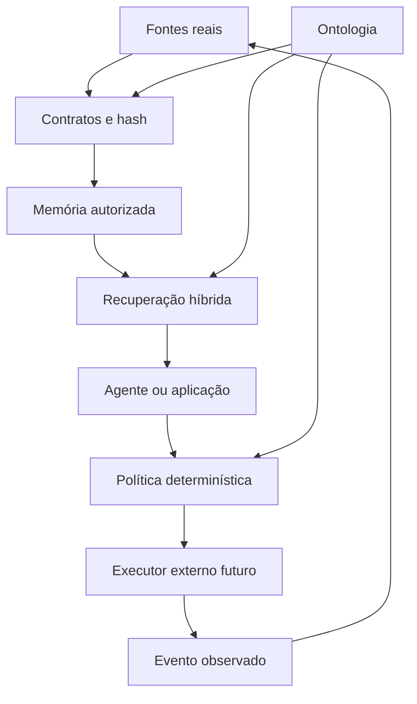
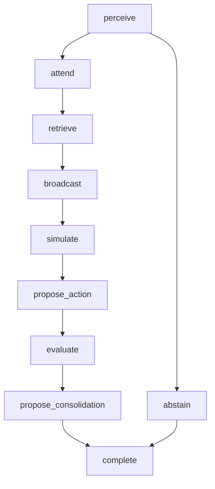

# Cortex Universal — manual técnico completo

Versão documentada: **0.6.0**
Estado do pacote: **experimental**  
Runtime de referência: **Node.js 22.13+**, TypeScript, Fastify e SQLite/FTS5  
Licença do repositório: **MIT**

Este documento explica o que o Cortex Universal é, como a ontologia organiza o sistema, como os
dados entram e são recuperados, como funcionam política, cognição, agentes, MCP, API, painel,
segurança, instalação, testes e extensão para um negócio real.

As afirmações deste manual descrevem a base até a versão 0.6.0. Para a camada de metas, trabalho,
orçamentos, rotinas, heartbeats, custos e avaliações inspirada no Paperclip, consulte também
[`PAPERCLIP-INTEGRATION.md`](PAPERCLIP-INTEGRATION.md). Identidade, Guard, reasoning, PostgreSQL e
mapeamento causal estão detalhados em
[`MAPEAMENTO-COMPLETO-OBSERVABILIDADE.md`](MAPEAMENTO-COMPLETO-OBSERVABILIDADE.md). Quando uma parte é
apenas base para trabalho futuro, isso é indicado explicitamente.

## Sumário

1. [Resumo executivo](#1-resumo-executivo)
2. [O que existe e o que não existe](#2-o-que-existe-e-o-que-não-existe)
3. [A ontologia como base de tudo](#3-a-ontologia-como-base-de-tudo)
4. [Arquitetura e autoridades](#4-arquitetura-e-autoridades)
5. [Estrutura do repositório](#5-estrutura-do-repositório)
6. [Núcleo e 34 módulos ontológicos](#6-núcleo-e-34-módulos-ontológicos)
7. [Validação: OWL, SHACL e JSON Schema](#7-validação-owl-shacl-e-json-schema)
8. [Dados reais e integridade do painel](#8-dados-reais-e-integridade-do-painel)
9. [Memória persistente e ingestão](#9-memória-persistente-e-ingestão)
10. [Recuperação híbrida](#10-recuperação-híbrida)
11. [Ciclo cognitivo governado](#11-ciclo-cognitivo-governado)
12. [Políticas, riscos e aprovações](#12-políticas-riscos-e-aprovações)
13. [Agentes e coordenação](#13-agentes-e-coordenação)
14. [API HTTP](#14-api-http)
15. [MCP](#15-mcp)
16. [Visualização semântica e operacional](#16-visualização-semântica-e-operacional)
17. [Segurança](#17-segurança)
18. [Instalação local](#18-instalação-local)
19. [Configuração](#19-configuração)
20. [Operação, persistência e backup](#20-operação-persistência-e-backup)
21. [Como adaptar para um negócio real](#21-como-adaptar-para-um-negócio-real)
22. [Testes e qualidade](#22-testes-e-qualidade)
23. [Limites atuais](#23-limites-atuais)
24. [Caminho para produção](#24-caminho-para-produção)
25. [Glossário](#25-glossário)

## 1. Resumo executivo

O Cortex Universal é uma ontologia empresarial modular acompanhada por um kernel semântico de
referência. Seu objetivo é oferecer uma estrutura comum para diferentes negócios sem colocar o
significado do negócio dentro de um prompt, de um LLM específico, de uma tabela específica ou de um
fornecedor de banco vetorial.

A versão 0.6.0 entrega:

- uma ontologia RDF/OWL com núcleo universal e **34 módulos**;
- **8** arquivos SHACL para validar grafos operacionais;
- **43** contratos JSON Schema;
- um motor determinístico de política com **26 ações** registradas e negação por padrão;
- um engine local SQLite/FTS5 para evidências, entidades, relações, embeddings e atividade;
- recuperação por palavra-chave, vetor e entidades do grafo, combinada por RRF;
- funções determinísticas de atenção, erro de previsão, calibração e consolidação proposta;
- um coordenador persistente com **4 agentes permitidos**;
- API HTTP documentada em OpenAPI 3.1;
- MCP v2 por stdio e Streamable HTTP;
- controle de força de trabalho com metas, tarefas, blockers, leases, rotinas, heartbeat, custos e QA;
- painel local com projeções 2D/3D do grafo declarado e rede operacional real;
- scripts de instalação para Windows, Linux e macOS;
- container endurecido e uma migração-base PostgreSQL/pgvector;
- testes automatizados de contratos, segurança, cognição e concorrência operacional.

O Cortex não é um cérebro biológico, não é consciente e não expõe a rede neural interna de um LLM.
Ele funciona como estrutura semântica, memória governada, validação, recuperação e coordenação.

## 2. O que existe e o que não existe

### 2.1 O que está implementado

| Capacidade         | Implementação atual                                           |
| ------------------ | ------------------------------------------------------------- |
| Significado        | RDF/OWL carregado a partir de uma allowlist no manifesto      |
| Validação de JSON  | AJV 2020 em modo estrito                                      |
| Validação de RDF   | SHACL sobre Turtle com limites de bytes e quads               |
| Política           | decisão determinística `allow`/`deny`, sem executar a ação    |
| Memória local      | SQLite com WAL e FTS5                                         |
| Recuperação        | keyword, vetor por cosseno e entidades do grafo               |
| Fusão de ranking   | Reciprocal Rank Fusion ponderada e determinística             |
| Atividade          | eventos operacionais persistidos por tenant e cérebro         |
| Cognição           | funções limitadas e auditáveis; sem chain-of-thought privada  |
| Agentes            | registro, sessão, handoff, hierarquia e personas              |
| Força de trabalho  | metas, tarefas, leases, rotinas, heartbeat, custos e revisão  |
| Interoperabilidade | HTTP/OpenAPI e MCP v2                                         |
| Visualização       | ontologia 2D/3D e rede operacional 2D somente com dados reais |
| Operação local     | scripts, Docker Compose e health checks                       |

### 2.2 O que não está implementado

- consciência, sentimentos ou identidade própria;
- uma réplica anatômica do cérebro;
- treinamento autônomo de pesos neurais;
- um modelo LLM embutido;
- geração de embeddings dentro do kernel;
- execução genérica de ferramentas, shell, SQL ou SPARQL;
- execução de pagamentos, mensagens, exclusões ou outras ações empresariais;
- identidade corporativa completa por OIDC ou mTLS;
- aprovação humana assinada;
- certificação LGPD, segurança ou conformidade regulatória.

## 3. A ontologia como base de tudo

### 3.1 Por que a ontologia vem primeiro

Um LLM reconhece padrões de linguagem, mas não deve ser a autoridade final sobre o significado de
cliente, pagamento, contrato, permissão ou evidência. A ontologia cria identidades estáveis para
esses conceitos e registra relações que continuam válidas mesmo se o modelo de IA, banco ou painel
for substituído.

No Cortex:

- classes definem tipos de entidade;
- propriedades definem relações e atributos;
- hierarquias permitem especialização sem duplicar o núcleo;
- SHACL define o que é obrigatório para aceitar dados operacionais;
- JSON Schema define as mensagens aceitas pela API;
- políticas decidem o que pode ser proposto;
- bancos e índices são projeções reconstruíveis, não autoridades semânticas.

### 3.2 TBox e ABox

| Camada | Conteúdo                                                              | Onde fica                                  |
| ------ | --------------------------------------------------------------------- | ------------------------------------------ |
| TBox   | classes, propriedades, hierarquias e restrições conceituais           | `ontology/` e `shapes/`                    |
| ABox   | instâncias de pessoas, contratos, eventos, evidências e estados reais | sistemas operacionais e storage autorizado |

O Git versiona a TBox. Dados empresariais reais não devem ser gravados no repositório.

### 3.3 Mundo aberto e contrato fechado

OWL trabalha em mundo aberto: a ausência de um fato não permite concluir que ele é falso. Isso é
adequado para integrar conhecimento incompleto. SHACL e JSON Schema introduzem fronteiras fechadas
nas operações: se um campo obrigatório estiver ausente, a entrada não é aceita.

### 3.4 Identidade e proveniência

- Uma IRI pública identifica um conceito de maneira estável.
- Rótulos podem evoluir; uma IRI não deve trocar de significado.
- Fatos contestáveis são modelados como claims com fonte e validade.
- `occurred_at`, `observed_at`, `valid_from` e `valid_until` têm significados diferentes.
- Relações com papel, tempo ou fonte devem ser reificadas como entidades próprias.
- Todo dado operacional sensível precisa de tenant e classificação.

## 4. Arquitetura e autoridades



O executor aparece no diagrama como fronteira futura. O repositório atual termina na validação,
decisão, proposta e registro; não executa o efeito empresarial.

### 4.1 Matriz de autoridade

| Camada              | Artefato                    | Autoridade                      | Não pode substituir    |
| ------------------- | --------------------------- | ------------------------------- | ---------------------- |
| Significado         | RDF/OWL                     | conceitos e relações            | sistema transacional   |
| Validade            | SHACL e JSON Schema         | forma aceita                    | autorização            |
| Política            | action registry e bundle    | decisão determinística          | identidade corporativa |
| Memória             | SQLite/FTS5                 | projeção local consultável      | ontologia              |
| Recuperação         | FTS, vetor, entidades e RRF | ranking de evidência autorizada | verdade factual        |
| Coordenação         | agent registry e sessões    | responsabilidade no workflow    | execução externa       |
| Visualização        | snapshot 2D/3D              | observação do grafo declarado   | atividade neural       |
| Sistema de registro | ERP, CRM, financeiro etc.   | estado empresarial confirmado   | índice semântico       |

### 4.2 Ordem de confiança

1. Identidade e escopo devem vir de infraestrutura autenticada.
2. Ontologia, schemas, shapes, ações e políticas vêm do pacote versionado.
3. Dados externos são não confiáveis até validação e proveniência.
4. Conteúdo recuperado nunca altera política ou permissão.
5. O LLM pode propor, mas não autoriza a própria proposta.
6. Um efeito só deve ser tratado como ocorrido após confirmação do sistema de registro.

## 5. Estrutura do repositório

| Caminho              | Responsabilidade                                                |
| -------------------- | --------------------------------------------------------------- |
| `ontology/core/`     | primitivas universais                                           |
| `ontology/modules/`  | 32 domínios reutilizáveis                                       |
| `ontology/profiles/` | perfis reais criados por uma organização; vazio na distribuição |
| `ontology/context/`  | contexto JSON-LD protegido                                      |
| `shapes/`            | regras SHACL                                                    |
| `schemas/`           | contratos JSON Schema 2020-12                                   |
| `policies/`          | ações, regras e agentes confiáveis                              |
| `src/brain/`         | contrato `BrainEngine` e adapter SQLite                         |
| `src/cognition/`     | algoritmos cognitivos determinísticos                           |
| `src/agents/`        | sessões e handoffs governados                                   |
| `src/mcp/`           | servidor MCP compartilhando os mesmos serviços                  |
| `src/app.ts`         | API Fastify, autenticação, limites e endpoints                  |
| `dashboard/`         | interface 2D/3D e atividade persistida                          |
| `storage/postgres/`  | baseline SQL com pgvector e RLS                                 |
| `local/`             | instalação e ciclo de vida local                                |
| `examples/`          | fixtures de conformidade; nunca dados operacionais              |
| `test/`              | testes automatizados                                            |
| `docs/`              | arquitetura, segurança, pesquisa, ADRs e operação               |
| `openapi.yaml`       | contrato HTTP                                                   |

## 6. Núcleo e 34 módulos ontológicos

### 6.1 Núcleo universal

O arquivo `ontology/core/cubo-core.ttl` contém 24 classes principais, incluindo `Entity`, `Agent`,
`Activity`, `Action`, `Event`, `Command`, `Claim`, `Evidence`, `Source`, `Tenant`, `Context`, `Role`,
`State`, `Policy`, `Risk`, `Resource`, `Goal`, `Metric` e classificações de dados.

### 6.2 Catálogo dos módulos

| Módulo               | O que representa                              | Classes centrais existentes                                                             |
| -------------------- | --------------------------------------------- | --------------------------------------------------------------------------------------- |
| `party`              | pessoas, organizações e relações entre partes | Person, Organization, Group, Address, ContactPoint, RoleAssignment                      |
| `organization`       | estrutura organizacional                      | OrganizationalUnit, Team, Position, Responsibility, Membership                          |
| `customer`           | conta e jornada de cliente                    | CustomerAccount, CustomerRole, Journey, JourneyStage, Opportunity, Segment              |
| `offering`           | produtos, serviços e direitos de uso          | Product, Service, Offer, Package, Plan, Benefit, Entitlement, PriceSpecification        |
| `agreement`          | acordos e compromissos                        | Agreement, Contract, Proposal, Term, Right, Obligation, SLA                             |
| `commerce`           | ciclo comercial                               | Cart, Order, OrderItem, Subscription, Fulfillment, Renewal, Cancellation                |
| `finance`            | registros financeiros conceituais             | Payment, Invoice, Refund, Charge, Credit, Transaction, MoneyAmount                      |
| `process`            | processos e trabalho                          | Process, Workflow, Step, Task, WorkItem, Case, Dependency, Transition                   |
| `communication`      | conversas e mensagens                         | Channel, Conversation, Message, Participant, Intent, DeliveryEvent                      |
| `knowledge`          | documentos e ativos de conhecimento           | Document, KnowledgeAsset, Citation, RetrievalChunk, AssertionSet, Version               |
| `agent`              | agentes, planos e capacidades                 | AIAgent, Tool, Capability, ActionDefinition, Plan, PlanStep, Approval                   |
| `tool-governance`    | proposta, decisão, execução e observação      | ToolProposal, GuardDecision, EffectExecution, EffectObservation, LoopBudget             |
| `agent-workforce`    | organização operacional de agentes            | AgenticGoal, WorkItem, WorkLease, Routine, Heartbeat, CostEvent, ReviewGate             |
| `policy`             | regras, consentimento e finalidade            | PolicyRule, Permission, Prohibition, Obligation, Consent, LegalBasis, ProcessingPurpose |
| `risk`               | risco e controle                              | RiskAssessment, Threat, Impact, Incident, Control, Mitigation                           |
| `metric`             | medição e metas                               | Metric, Indicator, Measurement, Unit, Target, ServiceLevelMetric                        |
| `integration`        | integração entre sistemas                     | System, API, Endpoint, Connector, Mapping, SyncJob, CredentialReference                 |
| `tenant`             | isolamento lógico                             | Workspace, Namespace, EncryptionDomain, RetentionProfile, ResidencyRequirement          |
| `audit`              | trilha de decisão e execução                  | AuditEvent, AuthorizationDecision, ExecutionRecord, ChangeSet                           |
| `identity-access`    | identidade e acesso                           | DigitalIdentity, Session, AccessGrant, PermissionAssignment, AuthenticationEvent        |
| `workforce`          | força de trabalho                             | Employment, WorkerRole, Skill, Competency, Availability, LearningActivity               |
| `project`            | projetos e entregas                           | Project, Portfolio, Milestone, Deliverable, WorkPackage, Stakeholder, ProjectRisk       |
| `asset`              | ativos físicos e digitais                     | Asset, PhysicalAsset, DigitalAsset, Equipment, InventoryItem, MaintenanceActivity       |
| `supply-chain`       | compras e logística                           | SupplierAccount, Procurement, PurchaseOrder, Shipment, Warehouse, InventoryMovement     |
| `service-management` | atendimento e operação de serviço             | ServiceRequest, ServiceIncident, SupportCase, Problem, ChangeRequest, Resolution        |
| `data-governance`    | governança de dados                           | DataAsset, Dataset, Schema, DataContract, DataLineage, DataOwner, DataSteward           |
| `privacy-compliance` | privacidade e solicitações do titular         | DataSubject, ProcessingActivity, PrivacyNotice, AccessRequest, ErasureRequest           |
| `memory`             | tipos e estados de memória                    | WorkingMemory, EpisodicMemory, SemanticMemory, ProceduralMemory, MemoryRecord           |
| `retrieval`          | recuperação e rastreabilidade                 | RetrievalRequest, RetrievalResult, RetrievalTrace, RetrievalChannel, AccessFilter       |
| `cognition`          | ciclo e artefatos cognitivos                  | CognitiveCycle, CognitiveStep, Hypothesis, Contradiction, KnowledgeGap, Evaluation      |
| `attention`          | seleção de conjunto de trabalho               | AttentionCandidate, AttentionSelection, BoundedWorkingSet, GlobalWorkspace              |
| `world-model`        | previsão, observação e erro                   | WorldState, Prediction, Observation, PredictionError, CounterfactualScenario            |
| `metacognition`      | confiança e calibração                        | ConfidenceJudgment, CalibrationAssessment, UncertaintySignal, ConflictSignal            |
| `learning`           | replay e proposta de consolidação             | ReplayCandidate, ReplayBatch, ConsolidationProposal, LearnedPattern                     |

### 6.3 Perfis

`profiles: []` no manifesto é intencional. A distribuição não inventa uma empresa, tenant ou
vocabulário setorial. Um perfil passa a existir somente quando uma organização define perguntas de
competência reais, seleciona módulos e adiciona termos no namespace que controla.

## 7. Validação: OWL, SHACL e JSON Schema

### 7.1 Oito conjuntos SHACL

| Arquivo                     | Finalidade                                              |
| --------------------------- | ------------------------------------------------------- |
| `core.shacl.ttl`            | identidade, claims, eventos e proveniência fundamentais |
| `operations.shacl.ttl`      | ações, comandos e operações                             |
| `security.shacl.ttl`        | tenant, classificação e referências seguras             |
| `governance.shacl.ttl`      | regras, governança e integridade de artefatos           |
| `memory.shacl.ttl`          | memória, evidência e recuperação                        |
| `cognition.shacl.ttl`       | artefatos e ciclos cognitivos                           |
| `tool-governance.shacl.ttl` | propostas, decisões, efeitos e limites do Guard         |
| `agent-workforce.shacl.ttl` | metas, trabalho, orçamento, custo, heartbeat e skill    |

O validador cria uma instância SHACL isolada por operação porque a biblioteca mantém estado interno.
Isso evita contaminação entre validações concorrentes.

### 7.2 Quarenta e três contratos JSON

| Grupo                   | Contratos                                                                                                                                                                                                | Proteção principal                                          |
| ----------------------- | -------------------------------------------------------------------------------------------------------------------------------------------------------------------------------------------------------- | ----------------------------------------------------------- |
| pacote e semântica      | `package-manifest`, `module-manifest`, `graph-snapshot`, `shacl-report`, `reasoning-report`                                                                                                              | inventário, grafo, conformidade e inferência limitada       |
| política e segurança    | `action`, `action-registry`, `policy-request`, `policy-bundle`, `policy-decision`, `source-registry`, `operation-registry`, `audit-integrity`, `sanitized-failure`                                       | allowlists, decisão, origem, auditoria e falhas sem payload |
| dados e memória         | `claim`, `event`, `ingestion-envelope`, `brain-ingestion`, `retrieval-request`, `retrieval-response`, `brain-activity`                                                                                   | proveniência, hash, escopo, evidência e recuperação         |
| cognição                | `attention-selection`, `prediction-observation`, `metacognitive-evaluation`, `consolidation-proposal`, `cognitive-cycle`                                                                                 | atenção, previsão, calibração, replay e sequência           |
| agentes, Guard e skills | `agent-registry`, `agent-session`, `agent-handoff`, `tool-proposal`, `guard-decision`, `effect-outcome`, `skill-registry`, `skill-trust-registry`                                                        | identidade operacional, efeitos e cadeia de suprimentos     |
| força de trabalho       | `workforce-goal`, `work-item`, `work-item-checkout`, `work-item-transition`, `workforce-routine`, `workforce-routine-materialize`, `workforce-heartbeat`, `workforce-cost-event`, `workforce-evaluation` | metas, execução, concorrência, orçamento, fatos e QA        |

AJV opera com JSON Schema 2020-12, formatos adicionais e modo estrito. Schemas desconhecidos não são
aceitos.

### 7.3 Allowlist do manifesto

Somente arquivos enumerados em `ontology/manifest.yaml` são carregados. O loader rejeita caminhos
absolutos, `..`, barras invertidas, segmentos vazios e symlinks que escapem da raiz após `realpath`.
O script de validação também compara diretórios declarados com o conteúdo real.

## 8. Dados reais e integridade do painel

### 8.1 Três fontes visíveis e separadas

1. **Estrutura declarada:** ontologia, SHACL, ações e políticas do pacote versionado.
2. **Atividade persistida:** registros realmente existentes na tabela `brain_activity` para o
   `tenant_id` e `brain_id` informados.
3. **Operação persistida:** metas, trabalhos, rotinas, heartbeats, avaliações e custos realmente
   existentes no snapshot da força de trabalho para o mesmo escopo.

O painel não cria tenant, cérebro, cliente, evento ou atividade de demonstração. Banco novo começa
com zero documentos e zero atividade.

### 8.2 O que o layout não significa

Posição, cor, tamanho e agrupamento são propriedades de apresentação. Elas não significam:

- anatomia cerebral;
- intensidade de ativação;
- pulso sináptico;
- peso neural aprendido;
- frequência de uso;
- certeza ou importância factual.

As setas representam apenas a direção de relações declaradas ou vínculos operacionais persistidos.
Não existem partículas ou pulsos simulados no painel 0.6.0.

### 8.3 Fixtures de teste

`examples/valid` e `examples/invalid` contêm entradas controladas para testar aceitação e rejeição.
Elas não pertencem ao manifesto, não são ingeridas automaticamente, não entram no SQLite e não são
mostradas no painel.

### 8.4 Snapshot verificado da versão 0.6.0

O snapshot gerado a partir dos artefatos declarados contém:

| Métrica                       | Valor |
| ----------------------------- | ----: |
| Nós                           |   928 |
| Arestas                       | 2.095 |
| Grupos de projeção            |    37 |
| Classes OWL                   |   275 |
| Propriedades de objeto        |   228 |
| Propriedades de dados         |   115 |
| Shapes                        |    37 |
| Ações projetadas              |    26 |
| Regras de política projetadas |    10 |

Os 37 grupos incluem o núcleo, os 34 módulos, referências externas e a projeção do runtime de
política. Esses números são específicos da versão 0.6.0 e devem ser recalculados após mudanças.

## 9. Memória persistente e ingestão

### 9.1 Contrato `BrainEngine`

O runtime depende de uma interface substituível com operações de ingestão, retrieval, atividade,
snapshot, saúde e fechamento. `EmbeddedBrainEngine` (`sqlite-fts5-hybrid`) atende o modo local;
`PostgresBrainEngine` (`postgresql-pgvector-hybrid`) é selecionado por `CORTEX_DATABASE_URL`.

### 9.2 Estruturas SQLite

| Estrutura                    | Conteúdo                                                             |
| ---------------------------- | -------------------------------------------------------------------- |
| `documents`                  | envelope, texto, hash, classificação, validade, embedding e citações |
| `documents_fts`              | índice textual FTS5                                                  |
| `document_entities`          | entidades citadas em cada evidência                                  |
| `brain_embedding_dimensions` | dimensão fixa por tenant/cérebro                                     |
| `semantic_relations`         | relações projetadas pela ingestão                                    |
| `brain_activity`             | atividade operacional persistida                                     |
| `agent_sessions`             | estado JSON de sessões e handoffs                                    |

O SQLite usa foreign keys, WAL, `synchronous=FULL`, timeout de 5 segundos e
`trusted_schema=OFF`. Fora de memória, o diretório é criado com modo `0700` e o banco recebe `0600`
quando o sistema operacional suporta permissões POSIX.

### 9.3 Passos da ingestão atual

1. A API valida o payload contra `brain-ingestion.schema.json`.
2. O engine calcula SHA-256 do texto UTF-8.
3. O hash calculado precisa coincidir com `envelope.content_hash`.
4. Tenant, cérebro, fonte, classificação, referência e proveniência são persistidos.
5. A chave de idempotência é consultada dentro do mesmo tenant/cérebro.
6. Embeddings, quando presentes, precisam ser vetores finitos.
7. A primeira dimensão de embedding fixa a dimensão daquele tenant/cérebro.
8. Entidades duplicadas na mesma projeção são rejeitadas.
9. Validade temporal incoerente é rejeitada.
10. Documento, FTS, entidades, relações e atividade são gravados em uma transação.

Uma repetição da mesma chave de idempotência retorna o ID existente com `accepted: false`.

### 9.4 Limite importante da autorização de ingestão

O endpoint de ingestão exige o bearer do serviço quando configurado, contrato válido e hash correto.
Ele **não chama automaticamente** `/v1/policies/evaluate` e não deriva tenant de uma identidade de
usuário. Em produção, um gateway/PEP precisa autenticar o principal, fixar o escopo autorizado e
executar a política antes de encaminhar a ingestão.

### 9.5 Como ingerir um registro verdadeiro

Primeiro grave exatamente o texto autorizado em `evidence.txt`. Calcule o hash sem alterar bytes:

```bash
node -e "const c=require('node:crypto');const f=require('node:fs');const t=f.readFileSync('evidence.txt','utf8');process.stdout.write('sha256:'+c.createHash('sha256').update(t,'utf8').digest('hex'))"
```

Monte o JSON usando identificadores, tempos, fonte e classificação reais:

```json
{
  "envelope": {
    "id": "<ID_REAL_E_ESTAVEL>",
    "tenant_id": "<TENANT_AUTORIZADO>",
    "brain_id": "<ESPACO_DE_MEMORIA_AUTORIZADO>",
    "source_id": "<SISTEMA_REAL_DE_ORIGEM>",
    "captured_at": "<DATA_HORA_ISO_8601>",
    "classification": "internal",
    "content_hash": "sha256:<HASH_GERADO_DO_TEXTO_EXATO>",
    "media_type": "text/plain",
    "content_reference": "<REFERENCIA_DURAVEL_A_FONTE>",
    "idempotency_key": "<CHAVE_UNICA_DA_OCORRENCIA>",
    "provenance": {
      "actor_id": "<ATOR_AUTENTICADO>",
      "system": "<SISTEMA_DE_ORIGEM>",
      "correlation_id": "<ID_DE_CORRELACAO>"
    }
  },
  "projection": {
    "text": "<CONTEUDO_EXATO_DE_EVIDENCE.TXT>",
    "citations": ["<REFERENCIA_DURAVEL_A_FONTE>"]
  }
}
```

Envie o arquivo final:

```bash
curl --fail \
  -H "Authorization: Bearer $CORTEX_API_TOKEN" \
  -H "Content-Type: application/json" \
  --data-binary @ingestion.json \
  http://127.0.0.1:8080/v1/brain/ingest
```

Não use os identificadores das fixtures como dados do negócio.

## 10. Recuperação híbrida

### 10.1 Escopo aplicado antes do ranking

Toda consulta filtra dentro do SQL por:

- `tenant_id`;
- `brain_id`;
- classificações permitidas;
- fontes opcionais;
- janela de validade opcional;
- módulos e entidades opcionais.

Os candidatos são limitados a 5.000 documentos autorizados antes dos canais. Cada canal retorna no
máximo 500 candidatos.

### 10.2 Canais

| Canal     | Implementação local                                | Peso RRF |
| --------- | -------------------------------------------------- | -------: |
| `keyword` | FTS5 com BM25 e tokenização Unicode                |      1,0 |
| `vector`  | similaridade de cosseno calculada no processo Node |      0,9 |
| `graph`   | correspondência de entidades por ID/rótulo         |      0,8 |

O modo vetorial exige `query_embedding`. O kernel não gera embeddings. O chamador precisa usar o
mesmo modelo/dimensão adotado na ingestão e governar esse processo fora do kernel.

### 10.3 Fusão

A implementação usa RRF ponderada:

\[
score(d)=\sum_c \frac{peso_c}{60+rank_c(d)}
\]

Empates são resolvidos de forma determinística pelo identificador. A resposta preserva a
contribuição de cada canal em `score_components`.

### 10.4 Lacunas explícitas

| Código                  | Significado                                 |
| ----------------------- | ------------------------------------------- |
| `no_results`            | nenhuma evidência autorizada correspondeu   |
| `uncited_result`        | resultado sem citação de suporte            |
| `stale_result`          | validade encerrada na data consultada       |
| `contradictory_results` | evidências autorizadas declaram contradição |

Ausência de evidência não é preenchida com texto inventado.

### 10.5 Limite do vetor local

O SQLite atual não possui índice vetorial ANN. Ele carrega embeddings dos candidatos autorizados e
calcula cosseno em JavaScript. `PostgresBrainEngine` usa a coluna `vector`, o índice HNSW e FTS do
PostgreSQL, sempre dentro da transação com o contexto RLS do tenant e do cérebro.

## 11. Ciclo cognitivo governado

As funções cognitivas são cálculos determinísticos sobre entradas contratadas. Elas não executam
ações, não expõem chain-of-thought e não alteram memória confiável por conta própria.

### 11.1 Atenção limitada

Cada candidato recebe valores entre 0 e 1 para relevância, alinhamento ao objetivo, novidade,
urgência e incerteza. Os pesos padrão são:

| Sinal                   | Peso |
| ----------------------- | ---: |
| relevância              | 0,30 |
| alinhamento ao objetivo | 0,25 |
| novidade                | 0,15 |
| urgência                | 0,20 |
| incerteza               | 0,10 |

Pesos customizados são normalizados. A capacidade aceita de 1 a 100 itens. A função devolve listas
`selected` e `deferred`, mantendo componentes do score.

### 11.2 Previsão e observação

Para cada previsão:

- o valor esperado e o observado precisam estar na mesma escala;
- a observação não pode ocorrer antes da previsão;
- evidência é obrigatória;
- erro absoluto é normalizado pela amplitude da escala;
- o erro agregado usa importância quando a soma de importâncias é positiva;
- `recommend_deliberation` é ativado quando o erro agregado alcança o limite informado.

Essa função mede erro; não atualiza automaticamente o modelo de mundo.

### 11.3 Metacognição

A avaliação recebe confiança entre 0 e 1, resultado correto/incorreto e evidências. Ela calcula:

- acurácia;
- confiança média;
- viés de calibração;
- Brier score;
- Expected Calibration Error;
- bins de confiança e acurácia.

O seletor auxiliar de modo rápido/deliberativo usa risco 0,35, incerteza 0,25, conflito 0,20 e erro
de previsão 0,20. É uma heurística operacional, não uma teoria da mente.

### 11.4 Consolidação

Candidatos de replay são ordenados por:

- surpresa: 0,25;
- qualidade da evidência: 0,25;
- saliência: 0,20;
- relevância ao objetivo: 0,20;
- recência: 0,10.

O retorno é sempre `status: review_required` e `writes_performed: 0`. Portanto, a função propõe o
que revisar; não promove memória episódica para semântica ou procedural.

### 11.5 Sequência do ciclo



Abstenção também pode ocorrer nos estágios intermediários permitidos. O validador verifica sequência
contígua, ordem temporal, transições, início em `perceive` e final em `complete` ou `abstain`.

## 12. Políticas, riscos e aprovações

### 12.1 Autoridade da política

`policies/action-registry.json` e `policies/default-policy.json` são carregados no startup, validados
e combinados em uma fingerprint SHA-256. Registro de ações, política, agentes, fontes e operações
acompanham a versão do pacote 0.6.0.

### 12.2 Ações confiáveis

| Ação                    | Risco | Aprovação      | Observação                                           |
| ----------------------- | ----: | -------------- | ---------------------------------------------------- |
| `ontology.validate`     |     1 | nunca          | validação sem efeito externo                         |
| `knowledge.read`        |     1 | nunca          | leitura com identidade e permissão                   |
| `claim.propose`         |     2 | política       | proposta reversível e idempotente                    |
| `subscription.activate` |     2 | política       | definição de referência; não é executada pelo kernel |
| `payment.refund`        |     3 | humana         | exige aprovação e verificação                        |
| `data.bulk_export`      |     4 | controle duplo | exige dois aprovadores independentes                 |
| `system.delete_tenant`  |     5 | proibida       | sempre negada no kernel de referência                |

As definições acima são configuração de política, não registros de operações já ocorridas.

### 12.3 Ordem de avaliação

1. Validar contrato da solicitação.
2. Localizar ação na allowlist.
3. Negar ação desconhecida, R5 ou proibida.
4. Verificar tenant para recurso não público.
5. Verificar classificação permitida pela ação.
6. Verificar todas as permissões.
7. Verificar todas as precondições.
8. Verificar negação de aprovação e autoaprovação.
9. Exigir aprovação humana ou dupla quando aplicável.
10. Verificar início e expiração da aprovação.
11. Aplicar regras; deny explícito tem precedência.
12. Sem regra allow correspondente, negar por padrão.

Uma decisão `allow` ainda não executa nada. Ela retorna regra, fingerprint, obrigações e ação de
verificação.

### 12.4 Limite da identidade

Papéis, permissões, tenant e aprovadores chegam no corpo da solicitação. O serviço valida a estrutura
e as regras, mas não comprova sozinho que o chamador tem direito de declarar esses campos. Em
produção, o gateway/PEP deve derivá-los de identidade autenticada e de um serviço de aprovação.

## 13. Agentes e coordenação

### 13.1 Registro permitido

| Agente         | Papel                  | Responsabilidade central                                    |
| -------------- | ---------------------- | ----------------------------------------------------------- |
| `orchestrator` | executive-orchestrator | metas, planejamento, delegação, rotinas e controle de custo |
| `ontologist`   | ontology-steward       | validade semântica, execução/revisão e heartbeat            |
| `retriever`    | evidence-retriever     | evidência autorizada, lacunas explícitas e heartbeat        |
| `verifier`     | independent-verifier   | revisão independente, avaliação e calibração                |

### 13.2 Sessão

Uma sessão grava:

- UUID da sessão;
- tenant e cérebro;
- objetivo;
- agente ativo;
- status;
- tempos de criação/atualização;
- histórico de handoffs.

### 13.3 Handoff

O handoff exige sessão ativa, escopo correspondente, `from_agent` realmente ativo, agente de destino
diferente, motivo e IDs de evidência. Ele troca responsabilidade registrada e persiste atividade.
Não inicia um LLM e não executa ferramenta externa.

### 13.4 Enforcement do registro

O coordenador verifica identidade, capacidade e classificação nas sessões e operações de força de
trabalho. A validação do repositório também rejeita chefe inexistente, autorreferência, ciclo de
reporte e skill desconhecida. Isso continua sendo uma allowlist do kernel, não um substituto para IAM,
sandbox, credenciais temporárias ou isolamento do executor.

### 13.5 Força de trabalho governada

O módulo `agent-workforce` e o `WorkforceService` acrescentam:

- metas com critérios de sucesso e ancestralidade;
- tarefas com responsável, capacidades, blockers, critérios, orçamento e revisão;
- checkout atômico com lease expirada e revisão otimista;
- rotinas que materializam tarefas, sem executar o trabalho;
- heartbeat observado com URI de evidência;
- custos append-only apenas quando medidos ou comprovadamente alocados;
- revisão independente e avaliação com evidência;
- snapshot tenant/brain para API, MCP e painel.

Detalhes, fluxo, contratos e limites estão em
[`PAPERCLIP-INTEGRATION.md`](PAPERCLIP-INTEGRATION.md).

## 14. API HTTP

Servidor padrão: `http://127.0.0.1:8080`.

### 14.1 Autenticação

- `/`, `/healthz`, `/readyz` e o shell `/dashboard/` são públicos no processo local.
- `/v1/*` exige bearer quando `CORTEX_API_TOKEN` está configurado.
- em `NODE_ENV=production`, o processo não inicia sem token;
- token configurado precisa ter ao menos 32 bytes;
- comparação usa SHA-256 e `timingSafeEqual`;
- respostas `/v1/*` recebem `Cache-Control: no-store`.

### 14.2 Endpoints

| Método e rota                                   | Função                     | Observação                    |
| ----------------------------------------------- | -------------------------- | ----------------------------- |
| `GET /`                                         | informações do serviço     | descoberta local              |
| `GET /healthz`                                  | liveness                   | processo está vivo            |
| `GET /readyz`                                   | readiness                  | consulta saúde do engine      |
| `GET /dashboard/`                               | shell do painel            | dados continuam protegidos    |
| `GET /v1/manifest`                              | manifesto ontológico       | autoridade declarada          |
| `GET /v1/graph`                                 | snapshot determinístico    | somente leitura               |
| `GET /v1/brain/health`                          | saúde do engine            | inclui contagem de documentos |
| `POST /v1/brain/ingest`                         | ingerir evidência validada | hash e idempotência           |
| `POST /v1/brain/retrieve`                       | recuperar evidência        | keyword/vector/graph          |
| `GET /v1/brain/activity`                        | ler atividade persistida   | tenant e cérebro obrigatórios |
| `GET /v1/agents/registry`                       | listar agentes permitidos  | somente leitura               |
| `POST /v1/agents/sessions`                      | criar sessão               | persiste estado               |
| `GET /v1/agents/sessions/:id`                   | ler sessão                 | exige tenant/cérebro na query |
| `POST /v1/agents/sessions/:id/handoffs`         | registrar handoff          | sem efeito externo            |
| `POST /v1/validate/json/:schema`                | validar JSON               | 200 válido, 422 inválido      |
| `POST /v1/validate/shacl`                       | validar Turtle             | `Content-Type: text/turtle`   |
| `POST /v1/policies/evaluate`                    | avaliar política           | nunca executa ação            |
| `POST /v1/cognition/attention/select`           | selecionar atenção         | conjunto limitado             |
| `POST /v1/cognition/prediction/evaluate`        | avaliar previsão           | calcula erro                  |
| `POST /v1/cognition/metacognition/evaluate`     | medir calibração           | Brier/ECE                     |
| `POST /v1/cognition/consolidation/propose`      | propor consolidação        | zero escritas                 |
| `POST /v1/cognition/cycle/validate`             | validar ciclo              | 200 ou 422                    |
| `GET /v1/workforce/snapshot`                    | ler força de trabalho      | somente registros reais       |
| `POST /v1/workforce/goals`                      | criar meta                 | idempotente                   |
| `POST /v1/workforce/work-items`                 | criar trabalho             | meta, agente e orçamento      |
| `POST /v1/workforce/work-items/:id/checkout`    | adquirir lease             | atômico                       |
| `POST /v1/workforce/work-items/:id/transitions` | mudar estado               | evidência e revisão           |
| `POST /v1/workforce/routines`                   | criar rotina               | sem efeito externo            |
| `POST /v1/workforce/routines/materialize`       | criar tarefas vencidas     | limitado e idempotente        |
| `POST /v1/workforce/cost-events`                | registrar custo            | medido e append-only          |
| `POST /v1/workforce/heartbeats`                 | registrar heartbeat        | observação com evidência      |
| `POST /v1/workforce/evaluations`                | avaliar agente             | revisor independente          |
| `POST /mcp`                                     | MCP Streamable HTTP        | stateless e autenticado       |

O contrato completo está em [`openapi.yaml`](../openapi.yaml).

### 14.3 Consultar atividade real

```bash
curl --fail \
  -H "Authorization: Bearer $CORTEX_API_TOKEN" \
  "http://127.0.0.1:8080/v1/brain/activity?tenant_id=<TENANT_REAL>&brain_id=<BRAIN_REAL>&limit=100"
```

Se o escopo não tiver atividade, a resposta correta é `{"activity":[]}`.

## 15. MCP

### 15.1 Transportes

| Transporte      | Inicialização                  | Proteção mínima                              |
| --------------- | ------------------------------ | -------------------------------------------- |
| stdio           | `npm run build && npm run mcp` | conta local e permissões dos arquivos        |
| Streamable HTTP | `POST /mcp`                    | bearer, rate limit, Host e Origin permitidos |

HTTP é stateless: cada requisição recebe uma instância de servidor/transport e ela é fechada ao fim.
`GET /mcp` e `DELETE /mcp` retornam 405.

### 15.2 Recursos

- `cortex://ontology/manifest` — inventário autoritativo;
- `cortex://ontology/graph` — snapshot somente leitura.

### 15.3 Ferramentas

| Ferramenta                       | Função                                            |
| -------------------------------- | ------------------------------------------------- |
| `cortex_manifest`                | ler manifesto                                     |
| `cortex_explore_graph`           | filtrar subgrafo com limite máximo de 500 nós     |
| `cortex_ingest_evidence`         | validar contrato e hash, depois indexar evidência |
| `cortex_retrieve_memory`         | executar retrieval híbrido no escopo              |
| `cortex_select_attention`        | calcular seleção limitada                         |
| `cortex_evaluate_predictions`    | comparar previsão e observação                    |
| `cortex_evaluate_metacognition`  | medir calibração                                  |
| `cortex_propose_consolidation`   | gerar proposta sem escrita                        |
| `cortex_evaluate_policy`         | avaliar política sem executar                     |
| `cortex_start_agent_session`     | iniciar sessão governada                          |
| `cortex_get_agent_session`       | ler sessão no escopo                              |
| `cortex_handoff_agent`           | registrar transferência                           |
| `cortex_read_activity`           | ler atividade persistida                          |
| `cortex_workforce_snapshot`      | ler força de trabalho persistida                  |
| `cortex_create_goal`             | criar meta governada                              |
| `cortex_create_work_item`        | criar trabalho governado                          |
| `cortex_checkout_work_item`      | adquirir lease atômica                            |
| `cortex_transition_work_item`    | aplicar máquina de estados e revisão              |
| `cortex_create_routine`          | criar rotina limitada                             |
| `cortex_materialize_routines`    | materializar tarefa sem executá-la                |
| `cortex_record_cost`             | registrar custo real                              |
| `cortex_record_heartbeat`        | registrar observação com evidência                |
| `cortex_record_agent_evaluation` | registrar avaliação independente                  |

Não há `execute_tool`, shell, SQL livre ou SPARQL livre.

### 15.4 Configuração de cliente stdio

```json
{
  "mcpServers": {
    "cortex-universal": {
      "command": "node",
      "args": ["/CAMINHO/REAL/cortex-universal/dist/mcp/stdio.js"],
      "env": {
        "CORTEX_ROOT": "/CAMINHO/REAL/cortex-universal",
        "CORTEX_DB_PATH": "/CAMINHO/REAL/cortex-universal/runtime/cortex.db"
      }
    }
  }
}
```

## 16. Visualização semântica e operacional

### 16.1 Construção do grafo

No startup, `createCortexGraphSnapshot` combina:

- núcleo e módulos RDF/OWL declarados;
- shapes SHACL;
- action registry;
- policy bundle.

O resultado é ordenado, deduplicado e validado pelo schema `graph-snapshot` antes do servidor aceitar
tráfego.

### 16.2 Modo 2D

AntV G6 exibe nós e relações, com layouts force, circular, concêntrico e grade. Busca e filtros atuam
no snapshot já autenticado.

### 16.3 Modo 3D

3D Force Graph exibe os mesmos nós e relações. Coordenadas iniciais e cores são determinísticas e
agrupam visualmente por módulo. Não representam atividade.

### 16.4 Atividade

O painel pede tenant e cérebro sem preencher valores. Ao clicar em “Consultar registros”, ele chama
`/v1/brain/activity` e renderiza o retorno via `textContent`. Nenhuma lista de demonstração é usada
quando a resposta está vazia.

### 16.5 Rede operacional real

Depois de informar tenant e cérebro, “Visualizar rede operacional” consulta
`/v1/workforce/snapshot` e o registro confiável de agentes. A projeção conecta chefia, metas,
trabalhos, blockers, rotinas, heartbeats e avaliações. Nenhum nó operacional é criado quando o
snapshot está vazio. Custos aparecem somente como totais medidos.

### 16.6 Token no navegador

O usuário pode selecionar o `.env` local ou colar a chave. O JavaScript mantém o token apenas em
memória; não utiliza `localStorage`, cookie ou query string.

## 17. Segurança

### 17.1 Controles presentes

- negação por padrão na política;
- token obrigatório em produção;
- logs redigem `Authorization`;
- CSP com scripts, estilos e conexões no mesmo origin;
- `frame-ancestors 'none'` e `object-src 'none'`;
- rate limit global padrão de 120 solicitações por minuto;
- limite de body padrão de 1.000.000 bytes;
- limite SHACL padrão de 10.000 quads;
- token comparado em tempo constante após hash;
- Host e Origin permitidos no MCP HTTP;
- `Cache-Control: no-store` em `/v1/*`;
- texto do painel inserido com `textContent`;
- banco local restrito ao proprietário;
- Docker sem root, sem capabilities e com filesystem somente leitura;
- volume separado para o SQLite;
- manifesto com caminhos verificados por `realpath`.

### 17.2 Classificações

O modelo aceita `public`, `internal`, `confidential` e `restricted`. O retrieval exige uma lista
explícita de classificações permitidas e filtra antes do ranking.

### 17.3 Segredos

Segredos não devem entrar no grafo, em prompts, logs ou exemplos. Use referências como
`vault://...`; o executor autorizado futuro resolve o valor apenas quando necessário.

### 17.4 Controles que continuam externos

- OIDC ou mTLS;
- derivação confiável de tenant, papéis e permissões;
- DLP e antivírus de documentos;
- secrets manager;
- aprovação assinada;
- WAF e quotas por tenant;
- criptografia de volume e backup;
- auditoria imutável;
- sandbox do executor;
- resposta a incidente e avaliação adversarial.

## 18. Instalação local

### 18.1 Windows

Pré-requisito: Docker Desktop em execução ou Node.js 22.13+ com `node:sqlite`.

1. Extraia o ZIP para uma pasta permanente.
2. Execute `INSTALAR-NO-WINDOWS.cmd`.
3. O instalador cria `.env` com 48 bytes aleatórios em Base64.
4. Se Docker estiver pronto, usa Docker; caso contrário, usa Node local.
5. No modo Node, executa `npm ci --ignore-scripts`, checks e build.
6. Aguarda `/healthz` e abre o painel.
7. No painel, selecione o `.env` para conectar.

Atalhos disponíveis:

- `INICIAR-NO-WINDOWS.cmd`;
- `PARAR-NO-WINDOWS.cmd`;
- `STATUS-NO-WINDOWS.cmd`;
- `TESTAR-NO-WINDOWS.cmd`.

### 18.2 Linux ou macOS

```bash
./local/unix/install.sh
./local/unix/status.sh
./local/unix/stop.sh
./local/unix/start.sh
```

O instalador usa OpenSSL ou Node para gerar o token, aplica `chmod 600` no `.env`, escolhe Docker ou
Node e mantém o bind em `127.0.0.1`.

### 18.3 Desenvolvimento

```bash
npm ci
npm run check
cp .env.example .env
npm run dev
```

Preencha um token aleatório antes de usar dados protegidos.

### 18.4 Docker

```bash
export CORTEX_API_TOKEN="$(openssl rand -base64 48)"
docker compose up --build -d
curl --fail http://127.0.0.1:8080/healthz
```

O Compose publica somente em loopback, limita memória a 512 MiB e PIDs a 128, remove capabilities,
impede novos privilégios e monta `/tmp` com `noexec`, `nosuid` e `nodev`.

## 19. Configuração

| Variável                   | Padrão                      | Regra                                            |
| -------------------------- | --------------------------- | ------------------------------------------------ |
| `NODE_ENV`                 | `development`               | em `production`, token é obrigatório             |
| `HOST`                     | `127.0.0.1`                 | não exponha diretamente à internet               |
| `PORT`                     | `8080` no `.env.example`    | inteiro de 1 a 65535                             |
| `CORTEX_API_TOKEN`         | vazio                       | mínimo de 32 bytes quando definido               |
| `CORTEX_LOG_LEVEL`         | `info`                      | fatal, error, warn, info, debug, trace ou silent |
| `CORTEX_MAX_BODY_BYTES`    | `1000000`                   | 1.024 a 10.000.000                               |
| `CORTEX_MAX_RDF_QUADS`     | `10000`                     | 100 a 100.000                                    |
| `CORTEX_RATE_LIMIT_MAX`    | `120`                       | 10 a 10.000 por minuto                           |
| `CORTEX_DB_PATH`           | `runtime/cortex.db`         | arquivo SQLite local                             |
| `CORTEX_ALLOWED_MCP_HOSTS` | `localhost,127.0.0.1,[::1]` | lista sem curingas                               |
| `CORTEX_ROOT`              | descoberta automática       | raiz com `ontology/manifest.yaml`                |

## 20. Operação, persistência e backup

### 20.1 Arquivos locais

No modo Node:

- banco: `runtime/cortex.db`;
- modo de instalação: `runtime/mode`;
- PID: `runtime/cortex.pid`;
- logs do ciclo local ficam em `runtime/` conforme o script de inicialização.

No Docker, o banco fica em `/data/cortex.db`, persistido no volume
`cortex-universal-data`.

### 20.2 Saúde

- `/healthz` confirma que o processo responde;
- `/readyz` confirma que o engine está pronto;
- `/v1/brain/health` retorna engine, persistência, FTS5 e quantidade real de documentos.

### 20.3 Backup do SQLite

Como WAL está habilitado, copiar apenas `cortex.db` enquanto há escrita pode produzir um backup
inconsistente. Para a referência local, pare o serviço antes da cópia ou use uma API/ferramenta de
backup SQLite que capture banco e WAL de forma consistente. Teste restauração em ambiente isolado.

### 20.4 PostgreSQL/pgvector

`storage/postgres/001_init.sql` cria:

- documentos e FTS;
- vetor com dimensão configurável;
- índice HNSW;
- entidades e relações;
- atividade append-only, sessões, reservas do Guard e execuções observadas;
- RLS habilitada e forçada em tabelas de tenant.

Cada transação deve definir `app.tenant_id`, `app.brain_id` e
`app.allowed_classifications` a partir do gateway. O dono das tabelas não deve ser o usuário de
runtime. `PostgresBrainEngine` aplica esses valores em cada transação e o startup falha quando schema
ou pgvector não estão prontos. O job `postgres-integration` do CI sobe PostgreSQL 16 com pgvector e
testa ingestão, recuperação, isolamento RLS e integridade da auditoria. Repita o teste contra a
infraestrutura real antes da entrada em produção.

## 21. Como adaptar para um negócio real

### 21.1 Não comece criando classes

Comece com 10 a 30 perguntas reais, por exemplo:

- Qual sistema confirma que este pagamento ocorreu?
- Qual evidência sustenta o estágio atual do cliente?
- Quem pode executar esta ação e em qual tenant?
- Até quando este dado é válido?
- Como verificar que uma automação produziu o efeito esperado?

### 21.2 Processo recomendado

1. Defina fonte de verdade de cada entidade e evento.
2. Mapeie dados pessoais, classificação, finalidade e retenção.
3. Selecione apenas os módulos necessários.
4. Crie namespace controlado pela organização.
5. Importe e especialize o núcleo; não copie classes.
6. Crie perfil em `ontology/profiles/<perfil>.ttl`.
7. Declare o perfil no manifesto.
8. Adicione SHACL para obrigatoriedade operacional.
9. Adicione schemas para mensagens novas.
10. Registre ações com risco, permissões, precondições e verificação.
11. Crie regras mantendo `default_effect: deny`.
12. Integre gateway, aprovação e executor fora do kernel.
13. Crie fixtures de teste claramente isoladas.
14. Rode toda a validação e revisão humana.

### 21.3 Integração com CRM, ERP, WhatsApp ou financeiro

Um conector deve:

1. autenticar no sistema de origem;
2. receber ou consultar um evento verdadeiro;
3. preservar ID e horário da origem;
4. atribuir tenant, classificação e finalidade autorizados;
5. calcular hash do conteúdo exato;
6. enviar envelope idempotente;
7. guardar `content_reference` para auditoria;
8. nunca enviar credenciais ao Cortex ou ao LLM;
9. reconciliar o efeito com o sistema de registro.

## 22. Testes e qualidade

### 22.1 Comando principal

```bash
npm run check
```

Esse comando executa:

1. verificação de formatação;
2. typecheck TypeScript;
3. build do dashboard antes dos testes;
4. testes Vitest;
5. validação integral do repositório.

### 22.2 Estado verificado da versão

- 14 arquivos de teste;
- 87 testes locais aprovados e 2 testes de integração PostgreSQL opcionais;
- 46 documentos Turtle analisados;
- 43 schemas compilados;
- 34 módulos declarados;
- 26 ações confiáveis;
- 4 agentes registrados;
- 69 operações HTTP/MCP mapeadas.

### 22.3 Invariantes testadas

- determinismo do grafo;
- endpoints de aresta válidos;
- ausência do antigo namespace de exemplo no snapshot;
- ausência de simulação de pulsos no dashboard;
- caminhos e arquivos declarados;
- fixtures válidas aceitas e inválidas rejeitadas;
- SHACL concorrente isolado;
- política default-deny e casos adversariais;
- hash, idempotência e dimensão vetorial;
- escopo de tenant/classificação no retrieval;
- persistência de atividade, sessões e handoffs;
- checkout concorrente, blockers, leases e orçamento de duração;
- revisão independente, custo real, heartbeat observado, rotina idempotente e isolamento workforce;
- limites e transições cognitivas;
- CSP e autenticação da API/MCP.

## 23. Limites atuais

| Limite                                           | Consequência                                              |
| ------------------------------------------------ | --------------------------------------------------------- |
| `node:sqlite` é experimental                     | referência local, não banco distribuído                   |
| identidade estática é apenas perfil local        | produção exige contexto assinado do gateway               |
| política cobre operações e propostas registradas | regras específicas do negócio ainda são externas          |
| registro de agentes é uma allowlist              | não substitui IAM, sandbox ou supervisão                  |
| vetor calculado em processo                      | escala limitada e sem ANN no SQLite                       |
| embedding vem do chamador                        | modelo/versão precisam de governança externa              |
| HMAC local não possui ancoragem WORM externa     | administrador do host ainda integra o limite de confiança |
| executores são conectores externos por ação      | o núcleo não inclui credenciais empresariais              |
| rotinas não executam agentes                     | scheduler e adapter reais permanecem integrações externas |
| skill registry começa vazio                      | nenhuma skill remota é confiada sem revisão e assinatura  |
| PostgreSQL depende de infraestrutura externa     | implantação deve medir HA, backup e desempenho            |
| sem modelo neural                                | painel não mostra pesos ou ativações de LLM               |
| package status experimental                      | requer revisão antes de uso crítico                       |

## 24. Caminho para produção

Antes de operar com dados sensíveis ou ações empresariais:

- colocar a API em rede privada atrás de TLS;
- autenticar usuário e workload por OIDC/mTLS;
- derivar tenant, papéis, permissões e finalidade no gateway;
- manter toda nova operação no registry e toda nova ação sob o Ontology Guard;
- usar aprovação assinada para R3/R4;
- implementar executores pequenos por capacidade;
- usar credenciais de curta duração e secret manager;
- aplicar a migração e repetir o teste do `PostgresBrainEngine` no ambiente de implantação;
- criptografar volume, backup e tráfego;
- exportar traces e ancorar a cadeia HMAC em armazenamento WORM externo;
- testar dois tenants em todos os stores, caches e índices;
- implantar DLP, antivírus, quarentena e reputação de fonte;
- avaliar prompt injection, poisoning e exfiltração;
- definir retenção, eliminação e direitos LGPD;
- testar backup, restauração, rollback e resposta a incidente;
- revisar ontologia e ações com especialistas do domínio.

## 25. Glossário

| Termo        | Definição neste projeto                                              |
| ------------ | -------------------------------------------------------------------- |
| Ontologia    | modelo formal de conceitos, relações e identidade                    |
| Cortex       | nome da arquitetura semântica; não anatomia cerebral                 |
| TBox         | definição de classes e propriedades                                  |
| ABox         | instâncias operacionais                                              |
| IRI          | identificador global de recurso semântico                            |
| Claim        | afirmação com fonte, validade e verificação                          |
| Evidência    | artefato que sustenta uma claim ou decisão                           |
| Tenant       | fronteira lógica de isolamento                                       |
| Brain ID     | espaço de memória dentro do tenant                                   |
| SHACL        | linguagem de validação de grafos RDF                                 |
| JSON Schema  | contrato estrutural de mensagens JSON                                |
| PDP          | componente que decide política                                       |
| PEP          | componente que impõe a decisão                                       |
| RRF          | fusão de rankings por posição recíproca                              |
| FTS5         | índice de texto completo do SQLite                                   |
| Embedding    | vetor derivado de conteúdo; também é dado sensível                   |
| MCP          | protocolo para recursos e ferramentas de agentes                     |
| Handoff      | troca registrada de responsabilidade entre agentes                   |
| Consolidação | proposta de promover padrões; não escrita automática                 |
| Abstenção    | decisão explícita de não continuar sem evidência/controle suficiente |

## Documentos relacionados

- [Arquitetura](architecture.md)
- [Modelo ontológico](ontology-model.md)
- [Integridade dos dados](data-integrity.md)
- [Organização do runtime](runtime-organization.md)
- [MCP](mcp.md)
- [Integração inspirada no Paperclip](PAPERCLIP-INTEGRATION.md)
- [Segurança](security-model.md)
- [Modelo de ameaças](threat-model.md)
- [Replicação](replication.md)
- [Governança](governance.md)
- [Perguntas de competência](competency-questions.md)
- [Instalação local](../local/README.md)
- [OpenAPI](../openapi.yaml)

---

Regra final: a ontologia define o significado; contratos definem a forma; política decide; memória
preserva evidência; retrieval recupera; agentes coordenam; o sistema transacional confirma o efeito.
Nenhuma dessas camadas deve fingir que outra já executou ou observou algo que não aconteceu.
