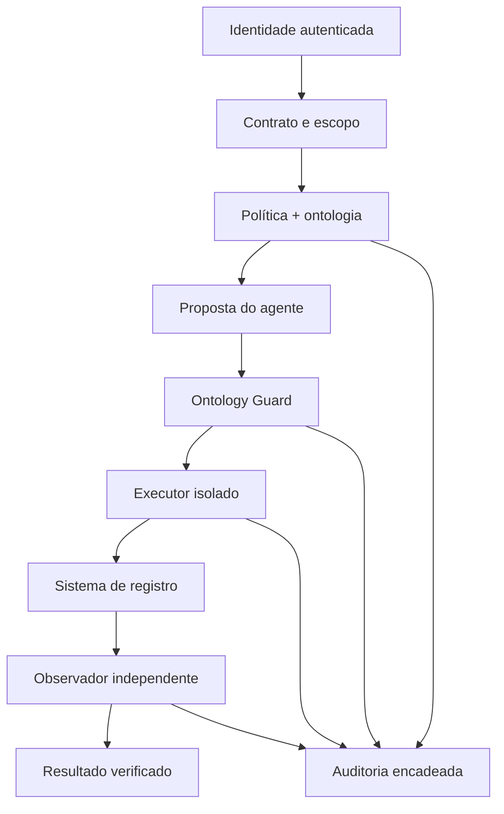

# Mapeamento completo do Cortex Universal 0.6.0

Este documento explica como o Cortex organiza significado, memória, agentes, decisões, efeitos,
telemetria e investigação de falhas. A ontologia continua sendo a autoridade semântica: bancos,
APIs, MCP e painel são projeções e mecanismos de acesso, não substitutos do modelo RDF/OWL.

## 1. O que o sistema é — e o que não é

O Cortex Universal é um kernel neuro-simbólico orientado a negócios. A parte simbólica fornece
conceitos, relações, contratos e políticas; as primitivas cognitivas fornecem atenção limitada,
recuperação, avaliação de previsões, calibração de confiança, ciclos e propostas de consolidação.
Ele não é consciência, cérebro biológico, modelo neural treinado nem executor universal.

O painel chama a visualização de “Cortex” porque representa a rede de significado e governança. Os
nós não são neurônios biológicos e as arestas não são sinapses aprendidas. O modo 3D usa exatamente
os nós e relações declarados. Não há pulsos, ativações ou tráfego inventados.

## 2. Autoridades e projeções

| Camada              | Autoridade                                          | Função                                            | Pode autorizar efeito? |
| ------------------- | --------------------------------------------------- | ------------------------------------------------- | ---------------------- |
| significado         | `ontology/core` e `ontology/modules`                | classes, propriedades, relações, domínios         | não                    |
| validade RDF        | `shapes/*.shacl.ttl`                                | regras fechadas para dados operacionais           | não                    |
| contratos           | `schemas/*.schema.json`                             | mensagens HTTP, MCP, guard, efeitos e registros   | não                    |
| ação confiável      | `policies/action-registry.json`                     | risco, capacidade, precondições e efeito esperado | participa              |
| decisão             | `policies/default-policy.json` + `PolicyEngine`     | allow/deny determinístico e deny-by-default       | sim                    |
| fontes              | `policies/source-registry.json`                     | origem, tenant, classificação e chave Ed25519     | autoriza ingestão      |
| agentes             | `policies/agent-registry.json`                      | capacidades e teto de classificação               | limita propostas       |
| skills              | `skill-registry.json` + `skill-trust-registry.json` | origem fixa, hash, assinatura verificada e acesso | limita injeção         |
| operações           | `policies/operation-registry.json`                  | mapa auditável de HTTP/MCP, falhas e correlação   | não                    |
| memória local       | SQLite/FTS5                                         | projeção single-node                              | não                    |
| memória distribuída | PostgreSQL/pgvector + RLS                           | projeção transacional de produção                 | não                    |
| painel              | G6 + 3D Force Graph                                 | observação e diagnóstico                          | não                    |

## 3. Fluxo completo e causal



Uma decisão `allow` do Guard sempre contém `effect_executed: false`. O `GovernedEffectBroker` exige
a decisão ainda válida, reserva a idempotência, chama um conector registrado para a ação e então
obriga outro componente a reler o sistema de registro. O recibo do executor não é prova do efeito.
O runtime não inclui conector empresarial fictício; uma implantação deve fornecer implementações
reais de `EffectExecutor` e `EffectObserver`.

## 4. IDs que ligam tudo

| Campo                | Origem confiável                       | Escopo              | Uso na investigação                          |
| -------------------- | -------------------------------------- | ------------------- | -------------------------------------------- |
| `request_id`         | transporte Cortex                      | uma requisição      | encontra a entrada HTTP/MCP                  |
| `trace_id`           | gerado dentro do Cortex                | fluxo técnico       | header, evento e falha sanitizada            |
| `correlation_id`     | header validado ou gerado internamente | fluxo de negócio    | liga chamador, Cortex e conectores           |
| `causation_id`       | serviço que conhece a causa            | evento pai          | explica qual proposta/sessão causou o evento |
| `proposal_id`        | agente sob contrato                    | intenção            | liga argumento por referência ao Guard       |
| `decision_id`        | Ontology Guard                         | autorização         | liga política, fingerprint e prazo           |
| `execution_id`       | executor isolado                       | tentativa de efeito | liga recibo à observação posterior           |
| `event_hash`         | armazenamento                          | evento imutável     | detecta alteração, remoção ou reordenação    |
| `policy_fingerprint` | bundle carregado                       | versão lógica       | reproduz exatamente a política avaliada      |

O Cortex devolve `x-cortex-trace-id` e `x-cortex-correlation-id` em todas as respostas. Um
`x-correlation-id` externo só é aceito quando respeita uma sintaxe limitada; o `trace_id` nunca é
aceito do chamador.

## 5. Auditoria persistente v2

Cada `BrainActivity` contém:

- sequência, horário, tenant e brain;
- tipo, estado, sujeito e resumo controlado pelo serviço;
- ator, operação, request, trace, correlação e causa;
- hash do detalhe, fingerprint da política e hash anterior;
- `event_hash` e método de integridade.

O resumo nunca deve receber payload bruto. `details_hash` permite comparar o artefato conhecido sem
copiá-lo para o log. O hash é calculado sobre uma serialização ordenada `cortex-audit-event-v2`.
Localmente pode usar cadeia SHA-256; produção exige `CORTEX_AUDIT_HMAC_SECRET` com pelo menos 32
bytes e usa HMAC-SHA-256. SQLite e PostgreSQL possuem triggers que rejeitam `UPDATE` e `DELETE` da
tabela de atividade. `/v1/audit/integrity` recalcula toda a cadeia do escopo solicitado.

A cadeia detecta adulteração dentro do banco. Para resistência contra um administrador que possa
substituir banco e chave ao mesmo tempo, exporte periodicamente o hash de fechamento para um log
WORM, cofre de evidências ou serviço de transparência administrado separadamente.

## 6. Telemetria e falhas sem vazamento

`CortexObservability` mantém métricas reais de requisições, erros, duração total, máxima, média e
taxa de erro por rota. Também emite métricas e spans pela API OpenTelemetry quando um provider é
configurado pela implantação.

O buffer de falhas é volátil e limitado. Cada entrada guarda somente:

- `failure_id`, horário, operação e status HTTP;
- código de erro normalizado e fingerprint SHA-256 da classe/mensagem;
- request, trace e correlação.

Ele deliberadamente exclui payload, query, resposta, token, identidade, tenant, brain e stack trace.
O endpoint `/v1/observability/failures` exige `observability.read`. O buffer ajuda triagem rápida;
a trilha persistente continua sendo a fonte para decisões e alterações de estado.

## 7. Registro de operações

`policies/operation-registry.json` mapeia as operações HTTP, recursos MCP e ferramentas MCP. Para
cada operação ele declara:

- método e caminho/nome;
- permissão necessária;
- tipo de auditoria;
- se não há efeito, há estado local ou efeito externo é proibido;
- tratamento de dados;
- campos de correlação esperados;
- códigos de falha conhecidos.

O registro segue `schemas/operation-registry.schema.json`. A validação do repositório verifica versão,
unicidade, permissões existentes e presença das ferramentas MCP no servidor. A versão 0.6 valida
**69 operações observáveis**.

## 8. Identidade, fontes e dados reais

O modo `static` atende uso local e exige configuração explícita em produção. O modo `gateway-hmac`
recebe um documento de identidade curto, assinado, com sujeito, tenants, papéis, permissões,
classificações, emissão e expiração. Wildcard de tenant é proibido em produção.

Uma evidência operacional só entra quando sua fonte consta do source registry e a assinatura
Ed25519 cobre o envelope estável. O único registro sem assinatura distribuído no projeto é
`conformance-fixture`, habilitado exclusivamente em desenvolvimento/teste. Exemplos são casos de
conformidade; não viram atividade do painel automaticamente.

Conteúdo de negócio fica atrás de `content_reference`. O hash protege a projeção textual. O Cortex
não cria clientes, pagamentos, agentes ativos, memórias, métricas ou falhas de demonstração.

## 9. Ontology Guard

O Guard valida o `tool-proposal`, o intervalo temporal, tenant, sessão ativa, agente atual,
capacidade, classificação, ação confiável, precondições, aprovação e política. Depois reserva a
proposta no banco antes de decidir. Os limites padrão são 32 propostas por sessão e três repetições
da mesma ação; ambos são configuráveis dentro de limites rígidos.

Duplicatas retornam a decisão persistida. Uma reserva incompleta após queda falha fechada e requer
reconciliação operacional; não é reexecutada silenciosamente. A ontologia e o SHACL do módulo
`tool-governance` descrevem proposta, decisão, execução, observação, verificação e orçamento de loop.

## 10. Raciocínio semântico

`reasonDataset` executa um subconjunto determinístico e limitado de RDFS/OWL-RL:

- equivalência, subclasse e subpropriedade;
- herança de tipo, domínio e range;
- propriedade inversa e transitiva;
- diagnóstico de classes disjuntas, instância de `owl:Nothing` e ambiguidade funcional.

Cada inferência registra regra e suportes. O relatório declara
`complete_owl_reasoner: false`, limites e truncamento. SHACL `maxCount` continua sendo o controle de
mundo fechado; `owl:FunctionalProperty` sozinho pode implicar igualdade em vez de rejeição.

## 11. Memória e recuperação

A ingestão valida origem, contrato, hash, temporalidade, dimensões vetoriais e idempotência. A
recuperação filtra tenant, brain e classificação antes de formar candidatos, combina keyword,
vetor e grafo por Reciprocal Rank Fusion, preserva citações e declara lacunas como ausência de
resultado, falta de citação, dado vencido ou contradição.

SQLite/FTS5 é a opção local. PostgreSQL/pgvector é selecionado por `CORTEX_DATABASE_URL`, executa
cada operação tenant-scoped em transação e configura RLS com valores derivados pelo serviço. O
startup falha se schema ou pgvector não estiverem prontos. O usuário da aplicação deve ser diferente
do owner, sem `BYPASSRLS`.

## 12. HTTP, MCP e painel

HTTP e MCP usam os mesmos schemas, política, source registry, memória e Guard. MCP não concede
autoridade adicional. O stdio é desabilitado em produção; MCP HTTP exige bearer e valida Host/Origin.

O painel oferece:

- grafo semântico 2D exato;
- organização 3D determinística dos mesmos dados;
- rede operacional real de agentes, chefia, metas, trabalho, blockers, rotinas, heartbeats e avaliações;
- inferências e consistência da ontologia;
- atividade persistida com operação e trace;
- verificação da cadeia de auditoria;
- falhas sanitizadas.

Para pesos e operações matemáticas de um modelo ONNX, PyTorch ou TensorFlow, use Netron em paralelo.
O grafo semântico explica significado e governança; Netron explica a arquitetura computacional do
modelo. Misturar os dois produziria uma visualização enganosa.

## 13. Investigação de uma falha

1. Capture `x-cortex-trace-id` e `x-cortex-correlation-id` da resposta.
2. Consulte `/v1/observability/failures` e filtre mentalmente pelo trace retornado.
3. Identifique operação, código, status e fingerprint, sem procurar payload no log.
4. Se houver tenant/brain autorizado, consulte `/v1/brain/activity`.
5. Siga `causation_id` para proposta/sessão e confira `policy_fingerprint`.
6. Para um efeito, compare proposal → guard decision → execution → observation → evidence.
7. Execute `/v1/audit/integrity` antes de confiar na sequência.
8. Reproduza com o mesmo contrato e política em ambiente isolado; nunca edite o evento existente.
9. Corrija código/política/ontologia por nova versão e registre um novo evento de resultado.

## 14. Configuração essencial

```dotenv
NODE_ENV=production
CORTEX_API_TOKEN=<mínimo 32 bytes aleatórios>
CORTEX_AUDIT_HMAC_SECRET=<mínimo 32 bytes, vindo de secret manager>
CORTEX_IDENTITY_MODE=gateway-hmac
CORTEX_IDENTITY_HMAC_SECRET=<mínimo 32 bytes>
CORTEX_DATABASE_URL=postgresql://cortex_runtime:...@db/cortex?sslmode=require
```

Sem `CORTEX_DATABASE_URL`, a instância usa `CORTEX_DB_PATH` e permanece single-node. Nunca grave
valores reais de segredo no `.env.example`, na ontologia ou no Git.

## 15. Verificação e limites restantes

Execute `npm run check` e `npm run build`. A suíte 0.6 inclui testes específicos para checkout
atômico, orçamentos, custos reais, heartbeats, rotinas, revisão independente e isolamento; o job
`postgres-integration` fornece `CORTEX_TEST_POSTGRES_URL` para executar também a integração contra
PostgreSQL 16 + pgvector. O conjunto testa contratos, SHACL, política, identidade
assinada, attestation Ed25519, reasoning, Guard, orçamento de loop, efeito observado, isolamento de
memória, headers de trace, sanitização, cadeia HMAC e triggers append-only.

Limites honestos:

- a implantação PostgreSQL precisa repetir o teste de integração na sua própria infraestrutura;
- OpenTelemetry precisa de provider/exporter da plataforma;
- conectores empresariais e observadores de sistema de registro são específicos do negócio;
- rotinas não invocam LLMs e heartbeats não são inferidos; um scheduler/adapter real continua externo;
- HMAC local não substitui ancoragem WORM externa;
- o reasoner é um subconjunto declarado, não OWL 2 DL completo;
- conformidade LGPD, segurança regulatória e semelhança com cognição humana não são certificadas.
