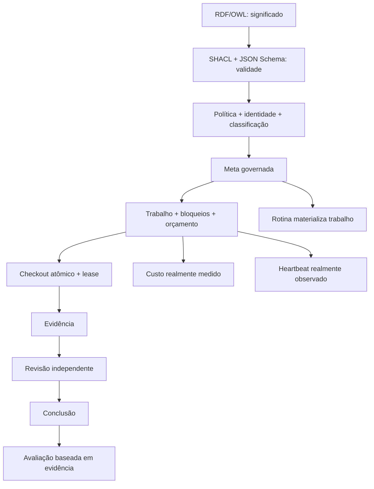

# Integração inspirada no Paperclip — arquitetura, segurança e operação

Versão: **Cortex Universal 0.6.0** — revisão de 2026-08-10.

Este documento descreve integralmente a camada de força de trabalho agêntica adicionada ao Cortex.
Ela aproveita ideias públicas do Paperclip, mas não incorpora seu código, seus dados, seus agentes ou
suas promessas de “empresa sem humanos”. A ontologia do Cortex continua sendo a autoridade de
significado; HTTP, MCP, bancos e painel continuam sendo projeções governadas.

## 1. Backup anterior à mudança

Antes de qualquer modificação foi criado e restaurado um backup do estado pré-Paperclip:

- tag Git anotada: `pre-paperclip-2026-08-10`;
- commit protegido: `221aa94f8f3aa1c04db04610ae117587eacdf480`;
- diretório local: `../backups/pre-paperclip-2026-08-10` a partir do workspace pai;
- bundle Git SHA-256: `8c140e94ec148dce65f3629dbaf509b690181d33adfdda899d0a0a8c1a0f4b97`;
- source tar SHA-256: `0235ba248637b08abfc362d0a855fff2482f99e90d5d6308274b683da8812112`;
- workspace com build SHA-256:
  `43eda2c7da28907b6899ca8245509d33eaa690edd0eb5f79ed73336248d125cc`.

O bundle passou em `git bundle verify`, foi clonado em diretório temporário e o `HEAD` restaurado
coincidiu com o commit acima. Os dois arquivos gzip passaram em teste de integridade. O arquivo
`RESTORE.md` dentro do backup contém os comandos de restauração.

## 2. Fontes e limites da pesquisa

As fontes primárias usadas foram o [repositório oficial do Paperclip](https://github.com/paperclipai/paperclip),
seu README e documentação pública. O vídeo
[Paperclip: Hire AI Agents Like Employees (Live Demo)](https://youtu.be/C3-4llQYT8o) foi usado para
identificar o fluxo demonstrado: definir meta, configurar uma organização local, atribuir um agente e
acompanhar trabalho. A apresentação
[Why Agentic Systems Need Ontologies](https://youtu.be/Sir59K8ZDPU) já havia sido sintetizada em
[`research/video-agentic-ontologies-2026-08-09.md`](research/video-agentic-ontologies-2026-08-09.md).

Os textos dos vídeos são protegidos por direitos autorais. O repositório contém sínteses técnicas e
marcações temáticas, não transcrições integrais. Afirmações de arquitetura foram confirmadas no
repositório/documentação oficial, e não inferidas apenas da demonstração em vídeo.

## 3. O que foi aproveitado

| Conceito público do Paperclip  | Implementação própria no Cortex 0.6.0                                                       |
| ------------------------------ | ------------------------------------------------------------------------------------------- |
| organização e linha de reporte | `agent-registry.json` declara papel, departamento, `reports_to`, persona e limites          |
| metas alinhadas                | `WorkforceGoal` exige critérios de sucesso e proprietário registrado                        |
| tickets/tarefas                | `WorkItem` exige meta ativa, responsável, capacidades, orçamento e critérios de aceite      |
| checkout atômico               | transação SQLite `BEGIN IMMEDIATE` ou PostgreSQL `SELECT … FOR UPDATE` cria lease exclusivo |
| bloqueios                      | `blocked_by` impede checkout até todos os trabalhos dependentes terminarem                  |
| orçamento                      | tetos por trabalho e agente controlam tokens, micro-USD e duração da lease                  |
| custos                         | eventos append-only aceitam apenas medição do provedor ou alocação comprovada por evidência |
| rotinas                        | rotinas de intervalo materializam trabalho rastreável; não executam efeito externo          |
| heartbeat                      | observação persistida exige agente, horário, status, escopo e URI de evidência              |
| revisão                        | máquina de estados exige evidência e impede autoaprovação quando revisão é obrigatória      |
| avaliação                      | outro agente registra qualidade, correção, eficiência e conformidade com evidência          |
| skills                         | registro fechado exige revisão, hash, revisão fixa e assinatura Ed25519 verificada para Git |
| painel                         | a rede operacional conecta somente registros existentes; escopo vazio produz tela vazia     |
| API e MCP                      | os dois transportes usam os mesmos contratos, política, identidade e armazenamento          |

## 4. O que foi recusado ou adiado

- **Zero-human e execução irrestrita:** não são invariantes aceitáveis. O Cortex preserva política,
  revisão e aprovação externa conforme risco.
- **Maximizer ou objetivos abertos:** não foram implementados. Toda tarefa precisa de meta, critérios,
  orçamento, estado terminal e autoridade limitada.
- **Custos estimados como fatos:** `measurement_status: estimated` é rejeitado pelo contrato.
- **Heartbeat fictício:** a configuração de intervalo não cria atividade. Um heartbeat só existe após
  uma observação com evidência.
- **Skills baixadas automaticamente:** o registro distribuído começa vazio. Nenhum código remoto é
  confiável até ser fixado, revisado, hasheado e, quando Git, assinado.
- **Executor universal de shell, SQL ou ferramentas:** não foi adicionado. Rotina e heartbeat
  organizam o trabalho; efeitos reais continuam atrás do Ontology Guard, executor mínimo e observador
  independente.
- **Importação do painel Paperclip:** não foi copiado. O painel existente foi ampliado com uma projeção
  própria baseada em AntV G6 e nos contratos do Cortex.

## 5. Por que a ontologia continua na base

O módulo [`ontology/modules/agent-workforce.ttl`](../ontology/modules/agent-workforce.ttl) define
`AgentOrganization`, `AgenticGoal`, `SuccessCriterion`, `WorkItem`, `WorkDependency`, `WorkLease`,
`Routine`, `Heartbeat`, `BudgetPolicy`, `CostEvent`, `ReviewGate`, `AgentEvaluation` e
`SkillManifest`. As formas SHACL em
[`shapes/agent-workforce.shacl.ttl`](../shapes/agent-workforce.shacl.ttl) aplicam requisitos fechados
a instâncias RDF.

O manifesto versionado decide quais módulos, shapes e schemas são confiáveis. O banco não cria novo
significado; apenas preserva projeções transacionais. O LLM não pode alterar manifesto, registros de
ação, política, hierarquia ou skill registry por meio de conteúdo recuperado.



## 6. Organização dos agentes

Cada agente confiável tem:

- identidade estável, nome, propósito, papel e departamento;
- chefe em `reports_to`, com validação de existência, autorreferência e ciclos;
- persona com princípios, comportamentos proibidos e critérios de sucesso;
- capacidades fechadas;
- IDs de skills que precisam existir no skill registry;
- orçamento máximo de tokens, micro-USD e duração por execução;
- intervalo mínimo de heartbeat;
- classificações que pode receber.

A organização distribuída possui quatro definições de configuração — orquestrador, ontologista,
recuperador e verificador. Isso não afirma que quatro processos ou LLMs estejam ativos. Um agente só
está trabalhando quando existe estado operacional persistido.

O `skill-registry.json` e o `skill-trust-registry.json` começam vazios. Skill empacotada é lida
somente dentro da raiz permitida e precisa coincidir com o SHA-256. Skill Git precisa de commit fixo,
chave ativa na trust store e assinatura Ed25519 válida sobre o manifesto canônico. Isso controla a
origem do pacote; execução ainda exige sandbox e permissões mínimas fora deste kernel.

## 7. Máquina de estados do trabalho

```text
ready --checkout atômico--> in_progress
ready --------------------> blocked | cancelled
in_progress --------------> review | blocked | failed | cancelled
blocked ------------------> ready | cancelled
review -------------------> approved | in_progress | failed
approved -----------------> completed | in_progress
completed | failed | cancelled -> terminal
```

Regras adicionais:

1. apenas o responsável executa a tarefa;
2. um planejador autorizado pode cancelar trabalho de outro agente;
3. blockers precisam estar `completed`;
4. lease vencida pode ser readquirida atomicamente pelo mesmo responsável;
5. lease não pode ultrapassar o orçamento de duração da tarefa nem do agente;
6. critério obrigatório exige pelo menos um ID de evidência ao entrar em revisão;
7. revisão obrigatória precisa de agente com `work.review`, diferente do executor;
8. conclusão exige aprovação quando a revisão é obrigatória;
9. cada atualização usa revisão otimista para detectar concorrência.
10. critério obrigatório do tipo `human-approval` força revisão independente.

## 8. Custos reais e orçamento

Um evento de custo informa provedor, modelo, tokens de entrada, saída e cache, custo em micro-USD,
horário, chave de idempotência e URI da prova. `total_tokens` é `input_tokens + output_tokens`;
`cached_input_tokens` é reportado separadamente porque normalmente é subconjunto da entrada.

O evento é factual e append-only: se uma medição comprovar estouro, ela continua sendo registrada.
O bloqueio acontece antes do próximo checkout. Rejeitar a medição excedente esconderia o gasto real.
SQLite e PostgreSQL rejeitam `UPDATE` e `DELETE` na tabela de custos.

## 9. Heartbeats e rotinas

O Cortex separa três conceitos:

- configuração de heartbeat: frequência mínima declarada no agente;
- observação de heartbeat: fato persistido com evidência e horário;
- rotina: agenda que cria trabalho rastreável quando vence.

`materializeDueRoutines` avança o próximo horário e cria no máximo 100 trabalhos por chamada. A chave
`routine:<id>:<scheduled_for>` torna a materialização idempotente. Ela não chama modelo, shell,
webhook ou API externa. Um scheduler autorizado pode chamar o endpoint; a política e o runtime do
agente continuam separados.

Um heartbeat `working` só é aceito se apontar para trabalho do mesmo agente em `in_progress` com
lease ativa no horário observado. `idle` e `offline` não podem apontar para trabalho. Isso evita que
uma declaração isolada seja exibida como atividade coerente.

## 10. API HTTP

| Método | Rota                                       | Função                                                             |
| ------ | ------------------------------------------ | ------------------------------------------------------------------ |
| `GET`  | `/v1/workforce/snapshot`                   | lê metas, trabalho, rotinas, heartbeats, avaliações e totais reais |
| `POST` | `/v1/workforce/goals`                      | cria meta idempotente                                              |
| `POST` | `/v1/workforce/work-items`                 | cria trabalho governado                                            |
| `POST` | `/v1/workforce/work-items/:id/checkout`    | adquire lease atômica                                              |
| `POST` | `/v1/workforce/work-items/:id/transitions` | aplica a máquina de estados                                        |
| `POST` | `/v1/workforce/routines`                   | cria rotina limitada                                               |
| `POST` | `/v1/workforce/routines/materialize`       | cria trabalho vencido, sem executá-lo                              |
| `POST` | `/v1/workforce/cost-events`                | registra medição imutável                                          |
| `POST` | `/v1/workforce/heartbeats`                 | registra observação de agente                                      |
| `POST` | `/v1/workforce/evaluations`                | registra avaliação independente                                    |

O contrato completo está em [`openapi.yaml`](../openapi.yaml). Mutação exige bearer, identidade,
tenant, classificação, permissão, precondições declaradas e validação por schema fechado.

## 11. MCP

As ferramentas correspondentes são:

`cortex_workforce_snapshot`, `cortex_create_goal`, `cortex_create_work_item`,
`cortex_checkout_work_item`, `cortex_transition_work_item`, `cortex_create_routine`,
`cortex_materialize_routines`, `cortex_record_cost`, `cortex_record_heartbeat` e
`cortex_record_agent_evaluation`.

MCP não contorna HTTP: usa a mesma instância de `WorkforceService`, os mesmos schemas e o mesmo
`GovernedAuthorizer`. O stdio é local e desabilitado em produção; Streamable HTTP continua protegido
por bearer, Host/Origin e rate limit.

## 12. Persistência e isolamento

SQLite oferece modo local e usa transação imediata no checkout. PostgreSQL usa transação tenant/brain,
RLS forçada e lock de linha. As tabelas são:

- `workforce_records`: metas, trabalhos, rotinas, heartbeats e avaliações versionadas;
- `workforce_cost_events`: medições append-only com unicidade por idempotência;
- `brain_activity`: trilha causal append-only das autorizações e alterações.

Todas as leituras recebem `tenant_id` e `brain_id`. O snapshot exige permissão para classificação
`restricted`, pois pode combinar registros de todas as classificações daquele escopo.

## 13. Painel

O seletor “Organização visual” possui:

1. grafo semântico 2D;
2. mapa ontológico 3D;
3. rede operacional real 2D.

A terceira opção só fica preenchida após o operador informar tenant/cérebro e consultar o endpoint.
Ela conecta agentes, chefia, metas, tarefas, dependências, rotinas, heartbeats e avaliações. Custos
aparecem como totais medidos. Posição, cor e tamanho são apresentação; não são neurônios, sinapses,
atividade cerebral ou confiança.

## 14. Auditoria e diagnóstico

Cada alteração gera `BrainActivity` do tipo `workforce`, com request, trace, correlação, causa,
ator, operação e fingerprint de política. Falhas HTTP entram no buffer sanitizado sem payload.
`operation-registry.json` mapeia todas as rotas e ferramentas, permissões, efeitos e falhas conhecidas.

Para investigar:

1. capture `x-cortex-trace-id` e `x-cortex-correlation-id`;
2. consulte `/v1/observability/failures`;
3. consulte `/v1/brain/activity` no tenant/cérebro;
4. siga `causation_id` até meta, trabalho ou agente;
5. execute `/v1/audit/integrity`;
6. compare critérios, evidências, revisão, custos e heartbeat;
7. corrija com novo evento/revisão; nunca altere um custo ou log histórico.

## 15. Testes e critérios de conclusão

A suíte cobre idempotência de metas, checkout concorrente, review independente, autoaprovação negada,
conclusão, custo real, custo duplicado, heartbeat com evidência, avaliação, isolamento de tenant,
materialização única de rotina e teto de duração. Contratos rejeitam custo estimado e heartbeat sem
evidência. `npm run check` ainda executa formatação, typecheck, testes, parsing Turtle, SHACL, schemas,
política, registros, hierarquia e integridade do pacote.

## 16. Limites honestos

- Não há adaptador de LLM ou scheduler rodando 24/7 dentro do kernel.
- Não há UI de criação/edição; o painel é observação autenticada.
- Skills confiáveis continuam vazias até revisão real.
- Não há templates de empresas com dados inventados.
- Orçamentos são hard-stop no checkout; uma medição já ocorrida é preservada mesmo acima do teto.
- Heartbeat prova a observação indicada pela URI, não prova consciência, qualidade ou disponibilidade
  futura.
- O Cortex aproxima organização e controle de agentes; não replica cérebro biológico nem pensamento
  humano completo.
