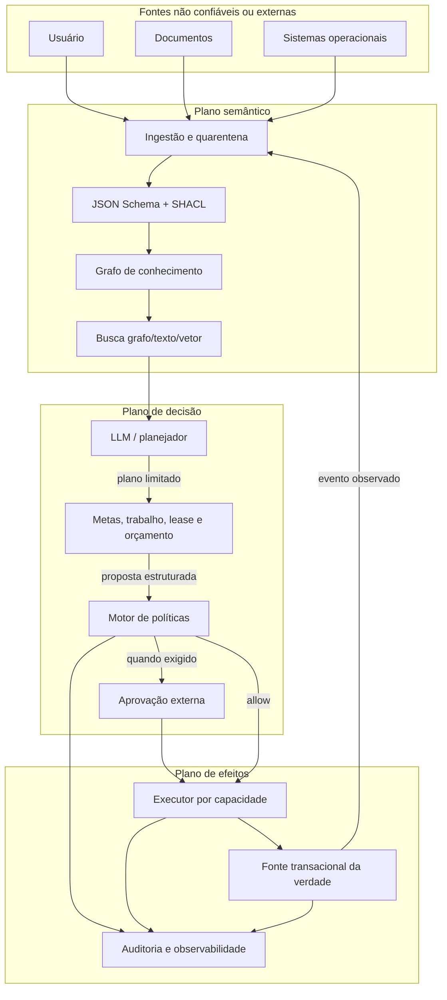

# Arquitetura de referência

## Resultado pretendido

O Cortex Universal é um kernel semântico portátil entre setores e fornecedores. Ele mantém significado, validação e autorização separados do modelo de IA, dos bancos e dos executores. Assim, trocar LLM, grafo, vetor ou sistema transacional não exige redefinir o negócio.

## Planos e responsabilidades

| Plano        | Autoridade                               | Nunca deve fazer                                  |
| ------------ | ---------------------------------------- | ------------------------------------------------- |
| semântico    | definir e validar significado            | executar ações ou conceder acesso                 |
| conhecimento | armazenar claims e evidências permitidas | substituir sistemas transacionais                 |
| raciocínio   | interpretar intenção e propor planos     | declarar a própria proposta autorizada            |
| política     | decidir de forma determinística          | confiar em regras vindas do RAG                   |
| execução     | realizar uma capacidade mínima           | escolher livremente nova ação ou escopo           |
| evidência    | registrar decisão, efeito e causalidade  | guardar segredo bruto ou conteúdo sem necessidade |

## Memória e recuperação híbrida

Os módulos `memory`, `retrieval` e `cognition` adicionam memória de trabalho, episódica, semântica e procedural; episódios temporais com origem; traces de recuperação; lacunas; contradições; hipóteses; sínteses e consolidações governadas. O contrato `BrainEngine` mantém o núcleo independente de armazenamento incorporado, PostgreSQL/pgvector, banco de grafo ou serviço remoto.

O fluxo esperado é contrato primeiro:

1. uma fonte entra por `IngestionEnvelope` com tenant, espaço cerebral (`brain_id`), classificação, hash, origem e chave de idempotência;
2. validação e política acontecem antes de indexar;
3. os índices de palavra-chave, vetor e grafo são projeções substituíveis da fonte autorizada;
4. cada canal retorna uma classificação; Reciprocal Rank Fusion ponderada produz ordem determinística;
5. resultados carregam citação, janela de validade e componentes de score;
6. falta de resultado, citação, atualidade ou consenso vira lacuna explícita, nunca preenchimento inventado;
7. síntese e consolidação geram propostas auditáveis, não escrita autônoma na memória confiável.

O filtro de tenant e classificação precisa acontecer dentro de cada mecanismo de busca, antes do cálculo dos candidatos. Filtrar apenas a lista final pode revelar similaridade, contagem ou tempo de resposta de dados proibidos.

## Ciclo cognitivo governado

A versão 0.3 acrescenta um ciclo explícito: perceber, selecionar atenção, recuperar, transmitir ao workspace, simular, propor ação, avaliar e propor consolidação. Cada passo referencia entradas, saídas, evidências, sequência e tempo; ele não registra ou exige chain-of-thought textual privada.

`attention` mantém um conjunto de trabalho com capacidade configurável e separa relevância, alinhamento ao objetivo, novidade, urgência e incerteza. `world-model` diferencia previsão, observação e erro. `metacognition` separa acurácia de confiança e permite medir calibração. `learning` ranqueia episódios para replay, mas sempre devolve uma proposta `review_required` com zero escritas. A ontologia define esses significados; os algoritmos TypeScript são apenas uma implementação de referência substituível.

O workspace global representa disponibilização de informação entre módulos, não consciência. Modelos de livre energia, Thousand Brains e redes pulsantes permanecem hipóteses ou adapters experimentais; não são impostos ao núcleo universal.

## Armazenamento executável

A versão 0.4 inclui `EmbeddedBrainEngine`, um adapter local e single-node sobre SQLite/FTS5. Ele verifica o SHA-256 do texto, grava envelope, evidência, embeddings, entidades, relações, atividade e sessões de agentes em transações. A dimensão vetorial fica fixa por tenant/brain depois do primeiro embedding. Duplicatas usam chave de idempotência. O arquivo recebe permissão `0600` e o diretório `0700` quando o sistema operacional permite.

O módulo `node:sqlite` ainda é marcado como experimental no Node 22/24. Por isso este adapter não é apresentado como banco distribuído de produção. `PostgresBrainEngine` implementa a projeção PostgreSQL/pgvector com FTS, HNSW, transações e RLS forçada; o CI sobe um servidor pgvector real para testar ingestão, recuperação, isolamento e auditoria. Cada implantação ainda deve validar sua infraestrutura, backup, restauração e desempenho.

## Grafo de visualização

No startup, `createCortexGraphSnapshot` projeta RDF/OWL, SHACL, registro de ações e bundle de política em um grafo somente leitura. IDs e ordenação são determinísticos; o snapshot é validado por JSON Schema antes de a aplicação aceitar tráfego. O endpoint autenticado `/v1/graph` serve esse snapshot com `Cache-Control: no-store`. O painel usa AntV G6 para precisão 2D e 3D Force Graph/Three.js para a projeção cortical, todos empacotados localmente sob CSP restritiva.

Este grafo representa conhecimento simbólico. Uma rede neural aprendida tem outra estrutura — camadas, operadores e tensores — e exigirá um artefato de modelo mais um visualizador próprio. Os dois níveis podem coexistir, mas não devem ser confundidos.

## MCP e agentes

O MCP oficial v2 expõe dois recursos somente leitura e ferramentas contratadas sobre os mesmos objetos usados pela API. Stdio herda a proteção do processo local; Streamable HTTP exige bearer token, valida `Host` e `Origin` e usa uma instância stateless por requisição. O registro de agentes é uma allowlist versionada. Sessões e handoffs persistem objetivo, agente ativo e evidências, mas não iniciam LLM nem executor externo.

O plano operacional acrescenta metas, tarefas, blockers, checkout atômico, leases, rotinas, custos
medidos, heartbeats observados e revisão independente. Esses registros concretizam os conceitos do
módulo ontológico `agent-workforce`; não criam uma segunda autoridade de significado. API e MCP
chamam o mesmo serviço, política e engine. Rotina apenas materializa trabalho e jamais executa tool.

## Escopo desta implementação

O serviço TypeScript carrega artefatos semânticos locais e imutáveis no startup. Ele devolve manifesto/grafo, valida JSON/RDF, avalia políticas e persiste projeções autorizadas de evidência. Não possui endpoint genérico de SPARQL, executor empresarial ou escrita no registro de ações. Essa ausência é uma barreira de segurança intencional.

Somente arquivos enumerados pelo manifesto são carregados. Caminhos relativos, `realpath` e schema do pacote impedem path traversal, symlink para fora do repositório e ativação acidental de um shape ou schema não declarado. Cada decisão inclui ID da solicitação e fingerprint SHA-256 do registro de ações mais o bundle de políticas.

Em produção, a API deve ficar em uma rede privada atrás de um gateway. O gateway autentica workload e usuário, deriva tenant, papéis e permissões e envia contexto já verificado. O token estático incluído é apenas controle mínimo entre serviços, não autenticação completa de usuário.

## Dados e consistência

Sistemas transacionais continuam sendo a autoridade sobre saldo, pagamento, contrato ou estoque. O grafo mantém relações, proveniência e projeções. Eventos têm `correlation_id` e `causation_id`; comandos de efeito precisam de chave de idempotência. Atualizações devem usar outbox transacional ou mecanismo equivalente para evitar divergência silenciosa.

## Escala e disponibilidade

A API de referência é stateless e pode ser replicada horizontalmente. Ontologias, shapes e políticas são carregadas por versão no deploy. Para grafos grandes, validação incremental ocorre antes da escrita; validações globais rodam em lote. Cache de decisão só é seguro quando inclui versão da política, identidade, tenant, ação, classificação e contexto relevante.

Validadores SHACL são instanciados por operação porque a biblioteca mantém estado interno. Payload e número de quads têm limites independentes, evitando que um arquivo pequeno mas estruturalmente denso consuma recursos sem limite.

Falha segura é o padrão: política, identidade, aprovação ou classificação indisponível resulta em negação. A indisponibilidade do LLM não deve impedir processos manuais essenciais.
