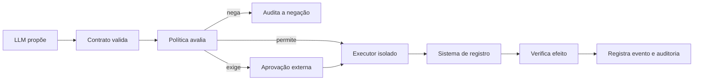

# Guia completo: ontologia como base de um córtex de IA

## O que está sendo construído

Uma ontologia não cria consciência nem substitui um modelo de linguagem. Ela funciona como o **esqueleto semântico** de um sistema cognitivo: define o que existe, como os conceitos se relacionam, quais afirmações são válidas, de onde vieram e quais ações podem ser consideradas. O LLM continua sendo um componente probabilístico de interpretação e planejamento; a ontologia torna sua relação com o negócio explícita, verificável e portátil.

O Cortex Universal separa nove capacidades que costumam ser confundidas:

1. **Vocabulário** — RDF/OWL dá identidade e significado aos conceitos.
2. **Memória semântica** — um grafo armazena entidades, eventos e afirmações contextualizadas.
3. **Validação** — SHACL e JSON Schema impedem dados operacionalmente inválidos.
4. **Recuperação** — busca textual, vetorial e por grafo encontra evidência relevante.
5. **Atenção** — seleção limitada escolhe o que entra no conjunto de trabalho.
6. **Predição** — um modelo do mundo compara expectativa, observação e erro.
7. **Metacognição** — calibração distingue confiança de acurácia real.
8. **Decisão** — o LLM pode propor; um motor determinístico autoriza ou nega.
9. **Ação** — executores isolados atuam em sistemas transacionais e depois verificam o efeito.

Este repositório implementa a ontologia, os contratos, SQLite/FTS5 local persistente, vetores fornecidos pelo chamador, recuperação híbrida, agentes coordenados, MCP, atenção, erro de previsão, calibração, ciclo auditável e decisão segura. Também inclui um painel 2D/3D. Geração de embeddings, percepção multimodal, identidade corporativa e executores de efeitos continuam integrações deliberadamente externas.

## Como isso se aproxima de um “cérebro”

| Analogia funcional  | Componente técnico           | Responsabilidade                                      |
| ------------------- | ---------------------------- | ----------------------------------------------------- |
| percepção           | conectores e parsers         | transformar sinais em eventos e afirmações candidatas |
| memória semântica   | ontologia + grafo            | representar significado e relações estáveis           |
| memória episódica   | event store + auditoria      | registrar o que ocorreu, quando e por qual causa      |
| memória de trabalho | `WorkingSet` limitado        | manter apenas o necessário para a decisão atual       |
| atenção             | seleção multissinal          | combinar relevância, objetivo, urgência e incerteza   |
| raciocínio          | regras + LLM + consultas     | inferir, comparar alternativas e criar planos         |
| imaginação          | cenário contrafactual        | simular futuros sem tratá-los como fatos              |
| córtex executivo    | políticas + aprovações       | decidir se uma ação proposta pode prosseguir          |
| sistema motor       | executores de ferramentas    | realizar ações autorizadas, idempotentes e limitadas  |
| metacognição        | avaliações + observabilidade | medir qualidade, incerteza, falhas e regressões       |

A analogia termina aí: o sistema não deve tratar texto gerado como fato, nem confiança do modelo como autorização.

## O núcleo universal

O núcleo contém primitivas que aparecem em praticamente qualquer organização: `Entity`, `Agent`, `Resource`, `Concept`, `Role`, `Relationship`, `State`, `Event`, `Command`, `Activity`, `Claim`, `Evidence`, `Source`, `Goal`, `Action`, `Policy`, `Risk`, `Metric`, `Place`, `TimeInterval`, `Context` e `Tenant`.

Essas primitivas são estáveis. Termos de domínio ficam em módulos opcionais:

| Domínio                              | O que representa                                                                                             |
| ------------------------------------ | ------------------------------------------------------------------------------------------------------------ |
| party e organization                 | pessoas, empresas, grupos, unidades, cargos e vínculos                                                       |
| customer                             | conta de cliente, ciclo de vida, segmento, jornada e oportunidade                                            |
| offering                             | produtos, serviços, ofertas, planos, benefícios, preços e direitos                                           |
| agreement                            | propostas, contratos, termos, direitos e obrigações                                                          |
| commerce e finance                   | pedidos, assinaturas, pagamentos, faturas e reembolsos                                                       |
| process                              | processos, casos, tarefas, etapas, dependências e transições                                                 |
| communication                        | canais, conversas, mensagens, participantes e intenções                                                      |
| knowledge                            | documentos, evidências, versões, citações e chunks de recuperação                                            |
| agent                                | agentes, ferramentas, capacidades, planos, precondições e efeitos                                            |
| policy e risk                        | permissão, proibição, consentimento, risco, controle e incidente                                             |
| metric                               | indicadores, medições, metas e unidades                                                                      |
| integration                          | sistemas, APIs, endpoints, conectores e referências de segredo                                               |
| tenant e audit                       | isolamento, retenção, residência, decisões e trilha de mudanças                                              |
| identity-access e workforce          | identidades, sessões, grants, emprego, papéis, skills e disponibilidade                                      |
| project e asset                      | portfólios, projetos, marcos, entregáveis, equipamentos e inventário                                         |
| supply-chain e service-management    | fornecedores, compras, remessas, solicitações, suporte e incidentes                                          |
| data-governance e privacy-compliance | data assets, lineage, ownership, processamento, retenção e direitos do titular                               |
| memory, retrieval e cognition        | memórias em camadas, episódios temporais, índices, traces, lacunas, contradições, sínteses e ciclo cognitivo |
| attention e world-model              | conjunto de trabalho, broadcast, previsões, observações, erros e cenários contrafactuais                     |
| metacognition e learning             | confiança, calibração, conflito, replay, padrões candidatos e consolidação com revisão                       |

“Universal” significa que o núcleo serve de linguagem de alinhamento; não significa antecipar todo conceito de toda indústria. Saúde, construção, seguros ou agronegócio devem ser perfis separados que importam o núcleo sem alterá-lo.

## O padrão mais importante: afirmações, não “verdades mágicas”

Uma informação operacional deve ser modelada como `Claim` quando sua origem, validade ou contestação importa. Cada claim tem:

- sujeito e assunto;
- tenant e classificação;
- fonte e evidência;
- instante observado e intervalo de validade;
- estado `proposed`, `verified`, `disputed`, `expired` ou `rejected`;
- confiança numérica, que nunca substitui verificação.

Conteúdo recuperado por RAG entra como evidência não confiável. Ele não altera políticas, permissões ou definições de ação. Uma nova claim passa por quarentena, validação e verificação antes de compor a visão operacional.

## Evento, comando e estado

- **Comando:** pedido para tentar uma mudança. Pode falhar e requer idempotência quando gera efeitos.
- **Evento:** registro imutável de algo que foi observado como ocorrido.
- **Estado:** projeção atual derivada de eventos e/ou do sistema transacional.

Misturá-los cria falsas memórias. `ActivateSubscription` não prova que a assinatura foi ativada; somente um evento observado após verificação pode provar o efeito.

## Ciclo seguro de uma ação

O registro de ações define capacidade, risco, precondições, permissões, efeitos esperados, política de aprovação, idempotência, reversibilidade, compensação e verificação. A referência bloqueia risco 5. Riscos 3 e 4 exigem aprovação humana e controle duplo conforme a política.

## Ciclo cognitivo antes da ação

O Cortex representa `perceive → attend → retrieve → broadcast → simulate → propose_action → evaluate → propose_consolidation`. Uma etapa pode terminar em `abstain` quando falta evidência. Cada transição registra apenas IDs de entrada, saída e evidência, não chain-of-thought privada.

## Como memória, agentes, API e MCP se organizam

“Micro-ontologias” são os módulos em `ontology/modules`: cada uma define uma região de significado, como cliente, finanças, memória ou atenção. O manifesto é o catálogo confiável que liga todas ao núcleo. Agentes não “inventam” esse mapa; consultam-no e só usam capacidades presentes em `policies/agent-registry.json`.

Na ingestão, o chamador fornece envelope, texto, entidades e embedding opcional. O Cortex confere contrato, hash SHA-256, tenant, brain, classificação, proveniência, validade e idempotência antes da transação. SQLite armazena a projeção; a ontologia continua sendo a autoridade semântica. Na consulta, filtros de tenant e classificação entram em cada canal antes do ranking. FTS5, cosseno vetorial e entidades do grafo geram listas; RRF produz a ordem final. Cada hit mantém citação, janela temporal e componentes de score.

A API HTTP e o MCP chamam exatamente os mesmos serviços. O MCP oferece recursos de manifesto/grafo e ferramentas limitadas para consultar, ingerir evidência, selecionar atenção, avaliar previsões/confiança, propor consolidação, avaliar política e iniciar sessão de agentes. Nenhuma ferramenta executa pagamento, mensagem, exclusão ou outro efeito empresarial.

A ontologia continua sendo a base: ela define o significado de candidato, workspace, previsão, observação, erro, julgamento de confiança e proposta de consolidação. JSON Schema e SHACL fecham o contrato; TypeScript apenas executa uma implementação substituível desses conceitos. Nenhum score algorítmico tem autoridade para alterar a ontologia, escrever memória confiável ou autorizar ação.

## O que falta para uma plataforma corporativa completa

Antes de chamar o conjunto de “cérebro empresarial”, conecte componentes de produção:

- provedor de identidade com OIDC ou mTLS;
- armazenamento transacional e/ou event store como fonte da verdade;
- PostgreSQL/pgvector gerenciado, aplicando a migração RLS incluída e repetindo os testes de integração no ambiente da empresa;
- geração de embeddings versionada, avaliada e separada por finalidade;
- pipeline de ingestão com quarentena e antivírus para documentos;
- secret manager e credenciais de curta duração;
- executores de ferramentas isolados por capacidade;
- aprovação humana fora do chat;
- logs imutáveis, métricas, tracing e alertas;
- avaliações contra prompt injection, vazamento entre tenants e decisões incorretas;
- processo jurídico e de privacidade aplicável ao país e ao setor.

## Painel do cérebro semântico

O painel em `/dashboard/` une classes e relações RDF/OWL, shapes SHACL, ações e políticas em um snapshot determinístico e somente leitura. O modo 2D prioriza precisão. O “Mapa ontológico 3D” mostra os mesmos nós e relações direcionais, agrupados visualmente por módulo. Não há pulsos, ativações ou dados de demonstração. É possível buscar, filtrar, inspecionar e exportar a visão filtrada. O endpoint de dados continua autenticado e a chave do `.env` permanece somente na memória do navegador.

Esse mapa explica o que o sistema declara saber representar e como governa ação. Cada ponto é uma entidade declarada na ontologia, em SHACL ou nos registros confiáveis de ações/políticas; não é um neurônio, uma ativação nem a rede neural interna de um LLM. A seção de atividade consulta somente eventos já persistidos no SQLite para o tenant e o cérebro informados. Camadas, operadores e tensores de um modelo ONNX/PyTorch/TensorFlow devem ser inspecionados no Netron quando esses artefatos reais existirem.

## Princípios para qualquer negócio

1. Modele identidade e significado antes de modelar telas ou prompts.
2. Mantenha o núcleo pequeno; expanda por módulos e perfis.
3. Use IRIs estáveis e nunca reutilize um termo com outro significado.
4. Separe dados mestres, claims, eventos, comandos e políticas.
5. Preserve proveniência e tempo; “último valor” isolado perde contexto.
6. Negue por padrão e trate todo conteúdo recuperado como não confiável.
7. Derive papéis e permissões da identidade autenticada, nunca do LLM.
8. Faça políticas e ações serem código versionado e protegido.
9. Minimize PII; armazene referências e hashes quando o conteúdo não precisa estar no grafo.
10. Teste perguntas de negócio e invariantes de segurança a cada mudança.

## Executar localmente no seu PC

No Windows, extraia o pacote e execute `INSTALAR-NO-WINDOWS.cmd`. Ele cria um token aleatório sem mostrá-lo, usa Docker Desktop quando disponível e cai automaticamente para Node.js 22.13+ com `node:sqlite` quando Docker não estiver ativo. Os atalhos de iniciar, parar e consultar status ficam na raiz. O serviço permanece em `127.0.0.1`, acessível apenas pelo próprio computador, e abre o painel em `http://127.0.0.1:8080/dashboard/`. Selecione o `.env` da pasta para conectar.

Leia também [arquitetura](architecture.md), [modelo ontológico](ontology-model.md), [segurança](security-model.md), [ameaças](threat-model.md) e [replicação](replication.md).
