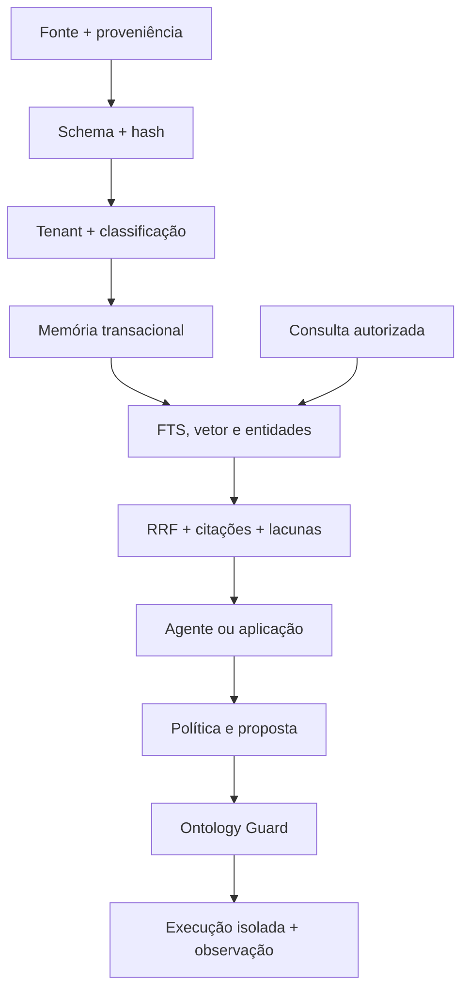

# Organização operacional do “cérebro”

## Autoridades e projeções

| Camada             | Artefato principal                 | Autoridade sobre                                      |
| ------------------ | ---------------------------------- | ----------------------------------------------------- |
| significado        | RDF/OWL em `ontology/`             | conceitos, relações e modularidade                    |
| validade           | SHACL + JSON Schema                | forma aceitável de grafo e mensagens                  |
| autorização        | action registry + policy bundle    | decisão determinística; conteúdo recuperado não manda |
| memória local      | SQLite/FTS5 em `runtime/cortex.db` | projeções consultáveis, não significado               |
| memória produção   | PostgreSQL/pgvector + RLS          | projeções transacionais, não significado              |
| recuperação        | keyword + vetor + entidades + RRF  | ordenação de evidência já autorizada                  |
| coordenação        | agent registry + sessions/handoffs | divisão de trabalho sem efeito externo                |
| força de trabalho  | metas + tarefas + leases + rotinas | execução organizacional rastreável e limitada         |
| custo/liveness     | eventos medidos + heartbeats       | fatos persistidos com evidência, nunca estimativas    |
| interoperabilidade | HTTP/OpenAPI + MCP                 | acesso contratado aos mesmos serviços                 |
| visualização       | G6 2D + 3D Force Graph             | observação, nunca decisão                             |

## Fluxo de nutrição e consulta

Uma micro-ontologia é um módulo importável, não um agente nem um banco separado. `customer` define
cliente; `memory` define episódio/evidência; `attention` define candidatos e workspace. O manifesto
liga todos os módulos ao núcleo universal e impede que um arquivo solto seja ativado por acidente.

## Limites conscientes

- O texto e o embedding entram juntos para que o hash proteja a projeção textual; a geração do
  embedding ocorre fora do kernel e precisa registrar modelo/versão no envelope quando relevante.
- SQLite serve uma instância local. O container guarda o arquivo em volume persistente. Backup deve
  copiar também o estado WAL de forma consistente ou usar uma API de backup/pausa controlada.
- PostgreSQL/pgvector possui adapter executável e RLS forçada. A implantação ainda precisa aplicar a
  migração em um servidor real, usar role não proprietária/sem `BYPASSRLS`, TLS, backup e teste de
  integração/restauração.
- Agente ativo significa responsabilidade no workflow, não que um LLM esteja rodando continuamente.
- Rotina vencida materializa trabalho; não chama um agente ou ferramenta por conta própria.
- Heartbeat registrado prova somente a observação referenciada; configuração de intervalo não cria
  liveness fictícia.
- O painel 3D não simula sinais. Setas representam somente a direção de relações declaradas.
  Atividade aparece separadamente e apenas quando já existe no endpoint tenant-scoped
  `/v1/brain/activity`.
- Reasoning é um subconjunto RDFS/OWL-RL limitado e explicável; o relatório declara quando truncado
  e nunca afirma ser um reasoner OWL 2 completo.
